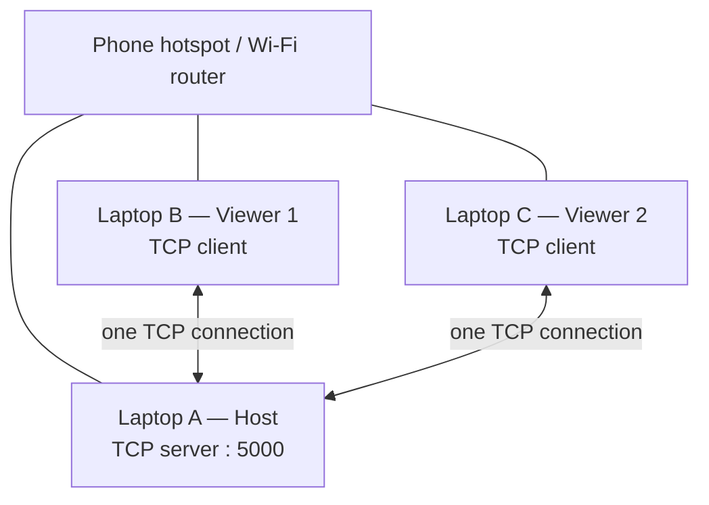
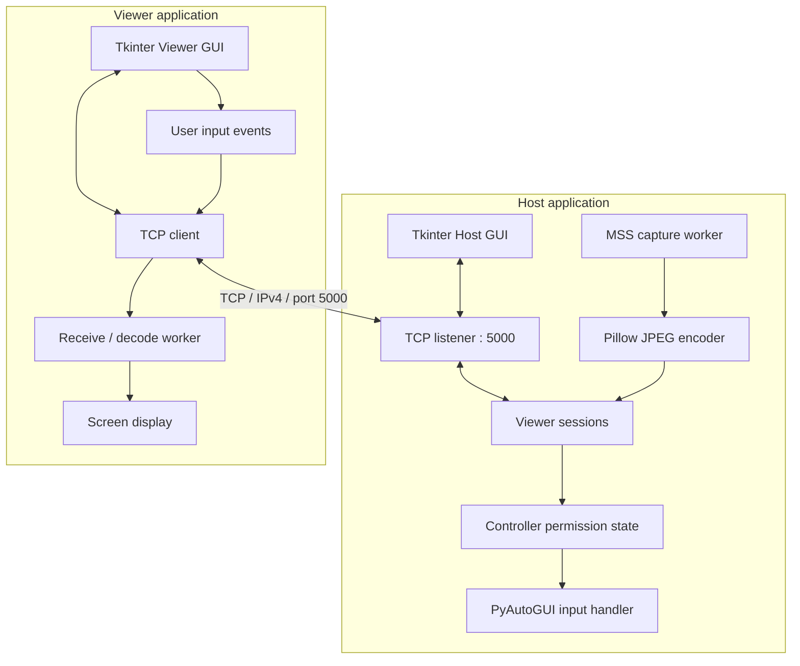
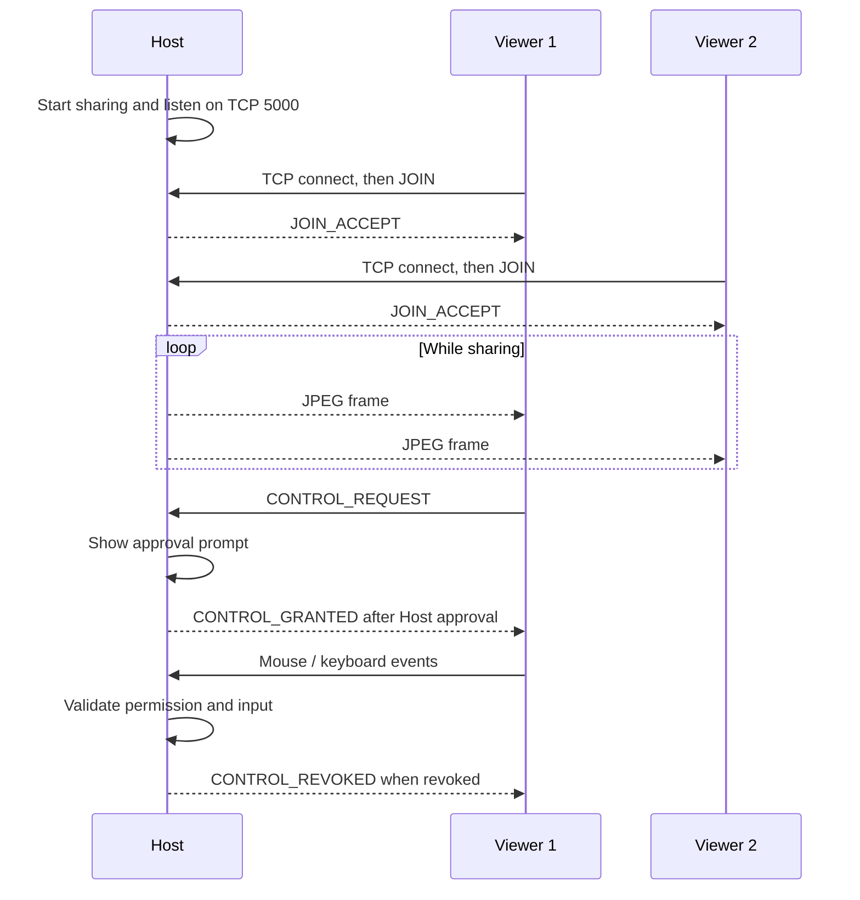
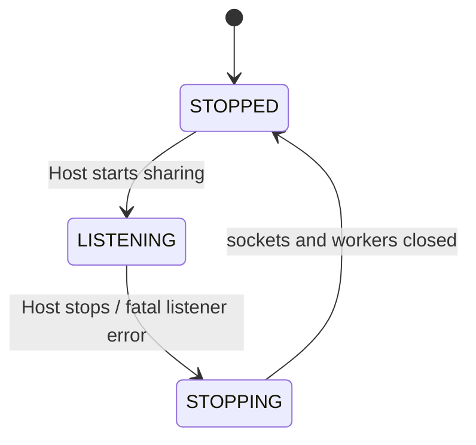
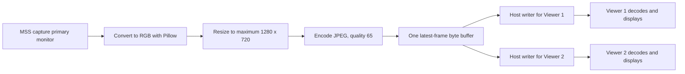
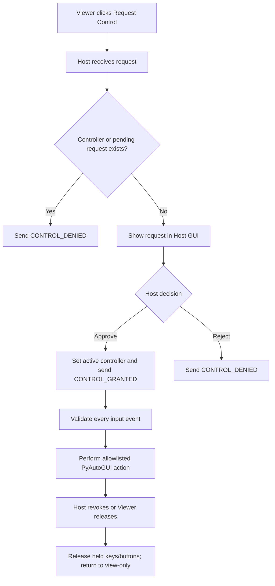

# Network-Based Screen Sharing and Remote Control System

## Final Implementation Architecture for Coding Agents

**Document version:** 5.0 (final)  
**Status:** Final implementation specification, including the demonstration kit  
**Course:** VTU B.E. Computer Science and Engineering — BCS502 Computer Networks  
**Scheme / semester:** 2022 Scheme / Semester V  
**Target environment:** Windows desktop computers on the same private Wi-Fi network or phone hotspot  
**Implementation language:** Python 3  
**Primary networking protocol:** TCP over IPv4  
**Application port:** TCP 5000 only (in the separate demo kit, section 25.4, `flow-recv` and `flow-send` use TCP 6000 and the other demos use ephemeral loopback ports; the application never opens 6000)

> **Purpose:** This file is the implementation contract for the coding agent. Follow the architecture, protocol, scope and acceptance criteria below. The goal is a small, understandable, demonstrable student project—not a production remote-desktop product.

---

# 0. Instructions for the Coding Agent

Treat this file as the source of truth for the first implementation.

1. Inspect the existing repository before creating, deleting, renaming or replacing files. Preserve useful working code and project configuration. Do not assume the repository is empty.
2. Implement the project in the development order in [Section 17](#17-implementation-order). Do not build every feature in one large, untested change.
3. Follow the exact one-port, one-connection-per-viewer design in this file. Do not restore the earlier two-connection design.
4. Use Python's standard library for networking, threading, queues, JSON, framing and tests. The only required third-party runtime packages are `mss`, `Pillow` and `PyAutoGUI`.
5. Keep functions and classes small. Prefer direct code over frameworks, dependency injection systems, plugin systems or complex abstractions.
6. Do not add internet relay, accounts, encryption, audio, file transfer, remote shell, mobile support, video codecs, custom TCP algorithms or other excluded features.
7. Do not call Tkinter widget methods from socket or capture workers. Send events to the GUI thread through a queue and process them with `root.after()`.
8. Do not allow more than one thread to write to the same TCP socket. Every established connection must have one serialized writer.
9. Do not disable PyAutoGUI's fail-safe. Do not execute commands supplied by a Viewer.
10. Add focused tests for protocol framing and single-controller permissions. Test on the actual Windows laptops and local network before claiming the application works.
11. Record actual test outcomes. Never invent throughput, frame rate, latency, packet events or successful testing.
12. When an implementation detail is not specified, choose the simplest solution that preserves the rules in this file. Do not introduce a new protocol, port or dependency to solve a problem that can be handled within the existing design.
13. Section 24 contains tested reference code (`protocol.py`, `latest_slot.py`, `outbox.py`, `keymap.py`, `geometry.py` and their tests). Copy it first, then build on it. Do not rewrite it. Wire constants live only in `protocol.py`.
14. Items marked **[U]** have not been run on Windows. Test them on the real laptops before saying they work.
15. The project is marked on 5 marks for the application working and 5 for the demonstration. A smaller design that works every time beats a larger one that fails once. Section 25 is the demonstration plan; keep it working at every stage.
16. Build the demonstration support in section 25.3 (Host statistics panel and the test-only slow-viewer setting) and copy `demo/transport_demos.py` unchanged. They are small and they carry half of the marks.
17. Sections 5.8, 7.6, 9.7 and 11.4 give exact rules for joining, threading, input and closing. Where the agent would otherwise guess, those sections decide.

## 0.1 Non-negotiable design decisions

| Concern | Required decision |
|---|---|
| Network topology | One Host, up to two Viewers for the first assessment demonstration |
| Network | Same private LAN / Wi-Fi / phone hotspot; no public relay |
| Address family | IPv4 |
| Transport | OS-provided TCP through Python `socket` |
| Server port | TCP 5000 only (application). The demo scripts in section 25.4 are separate programs and use 6000 |
| Connections | One full-duplex TCP connection per Viewer |
| Application framing | 5-byte header: `struct.Struct("!BI")` |
| Application message types | `1 = JSON`, `2 = JPEG` |
| Screen capture | MSS, captured once per frame on the Host |
| Image encoding | Pillow JPEG, initially quality 65 |
| Initial stream target | At most 1280 × 720, 5 FPS |
| Remote input | PyAutoGUI, Host-authorized, one active controller |
| GUI | Tkinter; GUI work stays on its owning thread |
| Packet analysis | Wireshark, capture the real TCP connection |
| Authentication | Temporary per-session code; plaintext over TCP; trusted LAN only |
| TCP reliability | Supplied by the operating system; no custom reliability layer |

## 0.2 Explicitly rejected earlier design elements

Do **not** implement these in the first version:

- A separate control connection and screen-stream connection.
- TCP port 5001 or any second listening port inside the application. (`demo/transport_demos.py` is a separate program with its own port 6000.)
- A stream-pairing token between two TCP connections.
- HMAC challenge-response, TLS, encryption or a custom authentication framework.
- `FRAME_ACK`, an application-level frame acknowledgement window, `AckWindow`, or custom retransmission logic.
- A custom congestion-control or TCP implementation.

These features increase implementation and explanation complexity without being needed for the required LAN demonstration. TCP already provides ordered, reliable byte-stream delivery. The application only needs message framing so it can separate JSON messages and JPEG frames.

---

## 0.3 Verified decisions (checked against the real packages and sources)

Tags: **[V]** verified here by running code or reading the source/PDF; **[U]** needs the real Windows laptops.

| # | Issue | Decision | Evidence |
|---|---|---|---|
| C1 | `pyautogui.PAUSE` was never set. PyAutoGUI sleeps 0.1 s after every call, so a mouse stream feels sluggish | Set `pyautogui.PAUSE = 0` at start-up | default `PAUSE` printed as 0.1 **[V]** |
| C2 | A remote cursor at a screen corner raises `FailSafeException` and would revoke control by accident. `x=0.0, y=0.0` maps to pixel (0, 0), which is a fail-safe point | Keep `FAILSAFE = True`, but nudge injected positions 1 px off `pyautogui.FAILSAFE_POINTS` with `avoid_points()` (section 24). Only the host's real mouse in a corner then triggers the emergency stop | `FAILSAFE_POINTS` printed as the four exact corner pixels **[V]**; `avoid_points` tested **[V]**; run against real PyAutoGUI 0.9.54 under a virtual display (Linux X11 backend; the Windows backend is **[U]**): all four nudged corners raised nothing, a raw corner raised `FailSafeException` on the next call, and the host's real pointer in a corner still triggers it **[V]** |
| C3 | `from mss import MSS` and `sct.primary_monitor` exist only from mss 10.2.0 ("versionadded:: 10.2.0" in the source). An unpinned install of an older mss fails at import | `mss>=10.2,<11`. In 10.2.0 the monitor is a plain dict (`monitor["left"]`, `["top"]`, `["width"]`, `["height"]`) | source read, import run on 10.2.0 **[V]** |
| C4 | DPI awareness not handled. pyautogui sets it when imported and mss when its object is created; without one deliberate call the two can disagree on a scaled laptop (125 %/150 %) | Call `ctypes.windll.shcore.SetProcessDpiAwareness(2)` inside `try/except` as the **first executable lines** of `app.py`, before importing tkinter, mss or pyautogui | pyautogui and mss source read **[V]**; behaviour on Windows **[U]** |
| C5 | Key names: the file says "Escape" but PyAutoGUI uses `esc`; Tkinter keysyms (`Return`, `BackSpace`) are not PyAutoGUI names | Use the table in section 9.2; wire format carries PyAutoGUI names | all 10 allowlisted non-alphanumeric names checked against `pyautogui.KEY_NAMES` (194 names) **[V]** |
| C6 | Scroll units unspecified | Tk wheel `event.delta` on Windows is a multiple of 120; send `delta // 120` notches as `amount`; the Host calls `pyautogui.scroll(amount * 120)` because PyAutoGUI passes the number straight to `mouse_event` as `dwData` (120 = one notch) | `_pyautogui_win._scroll` source read **[V]**; feel on Windows **[U]** |
| C7 | "Latest frame slot" had no wake-up mechanism; an agent would poll with `sleep` | `LatestSlot` (condition variable) in section 24 | 3 tests incl. wake-on-put **[V]** |
| C8 | Viewer decoded-image hand-off was a plain queue; a slow GUI makes it grow without bound | Viewer uses a `LatestSlot` too (section 8.5) | design rule |
| C9 | No JOIN timeout: a connection that never sends `JOIN` holds a thread forever | `sock.settimeout(10)` until `JOIN_ACCEPT` is sent, then `settimeout(None)` | **[U]** |
| C10 | No `TCP_NODELAY`: small mouse messages may be delayed by Nagle's algorithm | `setsockopt(IPPROTO_TCP, TCP_NODELAY, 1)` on every connection, both sides | standard socket option **[U]** effect |
| C11 | Session code compared with `==`; `secrets.compare_digest` on two `str` raises `TypeError` if either contains a non-ASCII character or is not a string, which would crash a reader on a malformed `JOIN` | Require `isinstance(code, str)`, then compare `code.encode("utf-8")` with the expected code encoded the same way (section 5.8) | `TypeError` reproduced by running it **[V]** |
| C12 | Framing, queues, key map and geometry code is needed first | tested reference code and 18 tests in section 24 | 18/18 pass **[V]** |
| C13 | The demonstration must not depend on luck with the Wi-Fi | a separate demo kit (section 25) whose boundary, port and flow-control results were run on loopback | outputs recorded in section 25.4 **[V]** |
| C14 | The capture pipeline in section 8.2 must match the real library | MSS, `primary_monitor`, `grab`, `Image.frombytes(... "BGRX")`, `thumbnail`, JPEG quality 65 and a decode were run end to end on mss 10.2.0 | ran under a virtual 1920x1080 display on Linux **[V]**; Windows **[U]** |

Also verified: the module list and practicals 3 and 7 in section 2 match the official VTU 2022-scheme PDF text (module titles, CIE 50 / SEE 50) **[V]**.

**Accepted limitation (measured earlier, not a bug):** without an application acknowledgement window, a viewer that is much slower than the stream can see frames several seconds old, because bytes already handed to TCP cannot be recalled. In a loopback experiment a 300 KB/s viewer saw frames about 4.5 s old, while a window of one unacknowledged frame gave 0.4 s **[V, loopback only]**. At 5 FPS and about 100 KB per frame (0.5 MB/s) a healthy LAN or hotspot is not expected to reach this **[I]**. This file keeps the simple design on purpose. If the hotspot test shows stale video, the cheapest fix is a lower `TARGET_FPS` or `JPEG_QUALITY`, not a new protocol.

---

# 1. Project Overview

The application allows one computer, called the **Host**, to share its desktop with other computers, called **Viewers**, on the same local network.

All connected Viewers can watch the Host's screen. A Viewer may request mouse and keyboard control. The Host must approve that request. Only one Viewer can control the Host at a time. The Host can revoke control at any moment.

The Host captures its screen, compresses it into JPEG, and sends the image to each Viewer through TCP. Viewers send control and permission messages back through their existing TCP connections.

## 1.1 Main objectives

1. Demonstrate TCP client-server socket programming between separate computers.
2. Share one Host screen with two Viewers at the same time.
3. Capture, resize and compress screen images.
4. Transmit and display the images over a local TCP connection.
5. Implement Host-approved, single-Viewer remote mouse and keyboard control.
6. Handle connection, disconnection, rejection, revocation and Host shutdown safely.
7. Use Wireshark to explain the actual TCP handshake, data transfer, acknowledgement fields and connection termination.

## 1.2 Supported first-version workflow

- Start the Host and display its LAN IPv4 address and temporary session code.
- Connect Viewer 1 using the Host IP and session code.
- Connect Viewer 2 using the same Host IP and session code.
- Both Viewers see the Host screen.
- A Viewer requests control; the Host approves or denies the request.
- Only the approved Viewer can send supported mouse and keyboard events.
- The Host can revoke control, approve a later request, disconnect a Viewer or stop sharing.

## 1.3 Non-goals

Do not implement the following in version 1:

- Internet access, cloud hosting, NAT traversal or a relay server.
- Audio, microphone, voice chat or video conferencing.
- File transfer or clipboard synchronization.
- Android, iOS or browser clients.
- More than one active controller.
- Remote shell, terminal, PowerShell, arbitrary code execution or remote process launch.
- Windows login-screen, UAC secure-desktop or protected-desktop control.
- Enterprise user management, persistent accounts or production-grade security.
- Video codecs, adaptive bitrate, dirty rectangles, GPU encoding, cursor overlays or multi-monitor selection.
- Custom implementation of TCP, TCP retransmission, congestion control or routing.

---

# 2. VTU BCS502 Syllabus Mapping

The official VTU 2022 Scheme syllabus lists **BCS502 — Computer Networks** in Semester V. The following is the accurate relationship between the course modules and this project.

| Module | Official syllabus coverage | Project relationship |
|---|---|---|
| **1 — Introduction** | Data communications, networks and network types, protocol layering, TCP/IP protocol suite, OSI model, physical media, guided and unguided/wireless media, packet switching | Supporting relevance: the Host and Viewers communicate over a LAN using the TCP/IP suite. The application does not implement physical media or packet switching. |
| **2 — Data Link Layer** | Error detection/correction, block coding, cyclic codes, framing, flow control, error control, data-link protocols, HDLC, MAC access methods, checksum and PPP | Not a primary focus. Do not claim to implement CRC, HDLC, PPP or data-link flow/error control. TCP flow control is a Transport Layer mechanism. |
| **3 — Network Layer** | Network-layer services, packet switching, IPv4 address/datagram, IPv6 datagram, routing algorithms, DVR, LSR, PVR, RIP, OSPF, BGP and MOSPF | Limited relevance: the Viewer connects to the Host's IPv4 address. The application does not implement routing protocols or packet forwarding. |
| **4 — Transport Layer** | UDP, TCP services and features, TCP segments and connections, flow control, error control and congestion control | **Primary academic focus.** The application uses OS-provided TCP through Python sockets. Wireshark is used to inspect the connection and TCP traffic. TCP itself is not reimplemented. |
| **5 — Application Layer** | Client-server programming, WWW/HTTP, FTP, email, DNS, TELNET and SSH | Supporting relevance: Host and Viewer are client-server application programs. This project does not implement those standard application protocols. |

## 2.1 Relevant official practicals

- **Practical 7:** TCP/IP socket client-server program where a client sends a file name and the server returns the file contents if present. This project is not that exact file-transfer exercise, but it uses the same basic TCP client-server socket model for screen frames and control messages.
- **Practical 3:** Ethernet LAN with multiple traffic sources and a congestion-window graph. This is a separate experiment and is not part of the screen-sharing application.
- **Simulation note:** The official syllabus mentions NS-2 or NS-3 for simulation experiments. Do not add an NS-2/NS-3 simulator to this application unless the project guide specifically requires a separate simulation demonstration.

## 2.2 Claims the team may make

The team may claim that the project demonstrates:

- TCP client-server communication and multiple client connections.
- A full-duplex TCP application connection.
- Application data transfer in both directions.
- TCP connection establishment and termination.
- Inspection of TCP sequence numbers, acknowledgement numbers, flags, advertised receive window and analysis events when they occur in the capture.

The team must not claim that the application itself implements TCP acknowledgement, retransmission, congestion control, routing, CRC, HDLC or a congestion-window algorithm.

**Official syllabus:** [VTU — 2022 Scheme, B.E. CSE, BCS502 Computer Networks](https://vtu.ac.in/pdf/2022_3to8/3cssyll.pdf).

---

# 3. Network Topology and Setup

## 3.1 Demonstration topology

Use three Windows computers connected to the same private Wi-Fi network or phone hotspot. The phone is only the Wi-Fi access point; it does not run the application.



Example IPs only (the actual hotspot may assign different addresses):

| Device | Example address |
|---|---|
| Hotspot / gateway | `192.168.43.1` |
| Host | `192.168.43.120` |
| Viewer 1 | `192.168.43.121` |
| Viewer 2 | `192.168.43.122` |

## 3.2 Host server binding

- Use `socket.AF_INET` and `socket.SOCK_STREAM`.
- Listen on TCP port `5000`.
- Bind to `0.0.0.0` so the Host can accept connections through its active LAN interface.
- Display the Host's Wi-Fi IPv4 address in the Host GUI. Do not display `127.0.0.1` as the address for other computers.
- Use a small listen backlog, such as `5`; application-level acceptance is limited to two Viewers.
- Reject additional authenticated Viewer sessions once `MAX_VIEWERS = 2` is reached.

The listening socket accepts connections only. Use the individual socket returned by `accept()` for each Viewer's data transfer.

## 3.3 Find the Host IPv4 address

On the Host laptop, run in PowerShell:

```powershell
ipconfig
```

Read the IPv4 address under the active Wi-Fi adapter. The Host application should show this address after the user starts sharing.

The Host application must not guess one address. Show **all** candidate IPv4 addresses (for example from `socket.gethostbyname_ex(socket.gethostname())`, and the address found by opening a UDP socket towards `8.8.8.8` and reading `getsockname()`, which sends no packet), put the best guess in an editable text field, and let the student correct it. Virtual adapters (VirtualBox, WSL, Hyper-V) often appear in the list. The UDP method needs a default route and fails on a hotspot without internet, so keep the list as the fallback **[I]**.

## 3.4 Test the network before development

After the Host is listening, run this from a Viewer laptop:

```powershell
Test-NetConnection <host-ip> -Port 5000
```

Expected result when the Host is reachable:

```text
TcpTestSucceeded : True
```

A failed `ping` by itself does not prove that the network is unavailable because ICMP may be blocked. Check the IP address, server state, Windows Firewall and hotspot client/AP isolation. Some phone hotspots prevent connected devices from communicating with each other. If so, use a private Wi-Fi router or another hotspot that permits device-to-device communication.

## 3.5 Windows Firewall

Allow inbound TCP port 5000 only on the trusted **Private** profile used for the demonstration. Do not disable Windows Firewall, create a Public-profile rule, or configure router port forwarding.

Optional PowerShell command (run on the Host in an elevated PowerShell window only when the team understands the profile scope):

```powershell
New-NetFirewallRule -DisplayName "Student Screen Share TCP 5000" -Direction Inbound -Protocol TCP -LocalPort 5000 -Action Allow -Profile Private
```

**Network profile and ICMP (frequent cause of a failed demo) [U].** Windows normally treats a newly joined Wi-Fi network, including a phone hotspot, as **Public**. A rule limited to the Private profile then does not apply and the Viewers cannot connect. Check with `Get-NetConnectionProfile`. If the Wi-Fi is Public, change it to Private in Settings, or in an elevated PowerShell window: `Set-NetConnectionProfile -InterfaceAlias "Wi-Fi" -NetworkCategory Private` (use the alias shown by the first command). Do this only on the trusted demo network.

Windows also blocks inbound `ping` (ICMP echo) by default, so `ping <host-ip>` and `tracert <host-ip>` can time out even when the TCP port works. If you want to show them, add on the Host, in elevated PowerShell: `New-NetFirewallRule -DisplayName "Demo ICMPv4 echo" -Protocol ICMPv4 -IcmpType 8 -Direction Inbound -Action Allow -Profile Private`, and remove the rule after the demonstration.

---

# 4. System Architecture

The same Python project provides two modes: Host and Viewer.



## 4.1 Host responsibilities

1. Start and stop the TCP listener.
2. Generate a temporary session code each time sharing starts.
3. Accept up to two Viewer connections.
4. Validate each Viewer's `JOIN` request.
5. Maintain one session object per authenticated Viewer.
6. Capture the Host's primary display once per frame.
7. Encode the captured frame into JPEG once and reuse the bytes for all Viewers.
8. Send the most recent frame to each Viewer without building an unlimited frame backlog.
9. Receive Viewer control requests and input events.
10. Enforce Host approval and the single-controller rule.
11. Revoke control and release held keys/buttons when required.
12. Close sessions and release resources when a Viewer disconnects or sharing stops.

## 4.2 Viewer responsibilities

1. Accept the Host IPv4 address and session code from the user.
2. Connect to TCP port 5000.
3. Send `JOIN`, and send it again on the same connection after `invalid_session_code` (section 5.8).
4. Receive screen frames and status/permission messages.
5. Decode JPEG bytes and display the image.
6. Request remote control.
7. Send supported input events only after receiving `CONTROL_GRANTED`.
8. Stop sending input immediately after denial, revocation or disconnect.
9. Send `DISCONNECT` when the user exits normally.

## 4.3 Main workflow



---

# 5. Application Protocol

## 5.1 Why application framing is required

TCP is a reliable, ordered byte stream. It does not preserve the boundaries of individual application `send()` calls. One `recv()` may return fewer bytes than requested or bytes from more than one application message. Therefore, the application must define its own message boundary format.

Use a fixed 5-byte header before every application payload.

```text
+-----------------------+--------------------------------+
| Type: 1 byte          | Payload length: 4 bytes        |
+-----------------------+--------------------------------+
```

The Python definition is:

```python
HEADER = struct.Struct("!BI")
```

- `!` = network byte order (big-endian).
- `B` = unsigned one-byte message type.
- `I` = unsigned four-byte payload length.
- Header size = exactly 5 bytes.

## 5.2 Message type codes

| Type code | Payload | Direction | Use |
|---:|---|---|---|
| `1` | UTF-8 JSON object | Both directions | Join, status, control and input messages |
| `2` | JPEG byte sequence | Host → Viewer only | Screen frame |

A Viewer must never send message type `2`. The Host must reject it if received.

## 5.3 Payload limits

| Payload | Maximum size |
|---|---:|
| JSON | 64 KiB (`64 * 1024` bytes) |
| JPEG | 4 MiB (`4 * 1024 * 1024` bytes) |

Check the type and declared length immediately after reading the header and **before** reading or allocating the payload. Reject unknown message types, invalid lengths, invalid UTF-8, malformed JSON and unexpected message directions. Do not attempt to process an oversized payload.

## 5.4 Required framing helpers

Implement these in `protocol.py`:

```python
def recv_exact(sock, byte_count: int) -> bytes:
    """Read exactly byte_count bytes or raise ConnectionClosed."""


def encode_message(message_type: int, payload: bytes) -> bytes:
    """Return the 5-byte header followed by payload; validate size/type."""


def recv_message(sock, direction: str) -> tuple[int, bytes]:
    """Read and validate one complete framed message."""


def encode_json_message(data: dict) -> bytes:
    """Serialize a JSON object as UTF-8 and add the type-1 header."""
```

Implementation rules:

- `recv_exact()` must loop until the requested byte count is received.
- If `recv()` returns `b""` before all requested bytes arrive, treat the connection as closed. Do not return a truncated message.
- Read exactly 5 bytes for the header, unpack it, validate type and length, then read exactly the payload length.
- Use `sendall()` for a complete framed message.
- Only the connection's writer worker may call `sendall()` on that socket.
- A send error makes the connection unusable; close that session rather than attempting to continue with a possibly incomplete frame.
- Decode type-1 payload as UTF-8 and require a JSON object with a string `type` field.
- Type-2 payload must be non-empty JPEG bytes and is accepted only Host → Viewer.
- Do not assume one TCP segment equals one application message.

## 5.5 JSON message contract

Use the following uppercase `type` names and fields. Do not invent different spellings between Host and Viewer.

| JSON `type` | Direction | Required fields | Purpose |
|---|---|---|---|
| `JOIN` | Viewer → Host | `protocol_version`, `client_name`, `session_code` | Authenticate and join a session |
| `JOIN_ACCEPT` | Host → Viewer | `viewer_id`, `host_name`, `screen_width`, `screen_height`, `fps` | Confirm a successful join |
| `JOIN_DENIED` | Host → Viewer | `reason` | Reject a join |
| `STATUS` | Host → Viewer | `viewer_count` (integer), `active_controller` (string or null), `pending_requester` (string or null) | Report current session state |
| `CONTROL_REQUEST` | Viewer → Host | none | Ask Host for control |
| `CONTROL_GRANTED` | Host → Viewer | none | Grant remote input permission |
| `CONTROL_DENIED` | Host → Viewer | `reason` | Deny a control request |
| `CONTROL_REVOKED` | Host → Viewer | `reason` | Revoke previously granted control |
| `CONTROL_RELEASE` | Viewer → Host | none | Viewer voluntarily releases control |
| `MOUSE_MOVE` | Viewer → Host | `x`, `y` | Normalized pointer position (0.0–1.0) |
| `MOUSE_BUTTON` | Viewer → Host | `button`, `action`, `x`, `y` | Mouse button down/up |
| `SCROLL` | Viewer → Host | `amount`, `x`, `y` | Scroll at normalized pointer position; positive amount scrolls up, negative scrolls down |
| `KEY_DOWN` | Viewer → Host | `key` | Press an allowlisted key |
| `KEY_UP` | Viewer → Host | `key` | Release an allowlisted key |
| `DISCONNECT` | Both | optional `reason` | End the application session |
| `ERROR` | Host → Viewer | `reason` | Report a protocol or session error when safe to do so |

Suggested `reason` values (the complete, exact lists are in section 5.8):

- `invalid_session_code`
- `viewer_limit_reached`
- `controller_busy`
- `request_pending`
- `host_rejected`
- `host_stopped`
- `unsupported_message`
- `invalid_input`

The GUI may display a friendly message for these values. Do not display a Python traceback to the end user.

## 5.6 Example payloads

`JOIN`:

```json
{
  "type": "JOIN",
  "protocol_version": 1,
  "client_name": "Laptop B",
  "session_code": "ABCD2345"
}
```

`JOIN_ACCEPT`:

```json
{
  "type": "JOIN_ACCEPT",
  "viewer_id": "host-generated-session-id",
  "host_name": "Laptop A",
  "screen_width": 1280,
  "screen_height": 720,
  "fps": 5
}
```

`STATUS`:

```json
{
  "type": "STATUS",
  "viewer_count": 2,
  "active_controller": "Laptop B",
  "pending_requester": null
}
```

`MOUSE_MOVE`:

```json
{
  "type": "MOUSE_MOVE",
  "x": 0.5,
  "y": 0.4
}
```

`MOUSE_BUTTON`:

```json
{
  "type": "MOUSE_BUTTON",
  "button": "left",
  "action": "down",
  "x": 0.5,
  "y": 0.4
}
```

`KEY_DOWN`:

```json
{
  "type": "KEY_DOWN",
  "key": "enter"
}
```

The 5-byte header is sent before every JSON payload shown above. A JPEG frame is sent as a type-2 header followed directly by JPEG bytes; it is not wrapped in JSON or Base64.

## 5.7 Session validation rules

- The first application message from a new Viewer must be `JOIN`.
- `protocol_version` must equal `1`.
- `client_name` must be a non-empty printable string with a maximum length of 32 characters.
- A Viewer must not send input until it has received `JOIN_ACCEPT` and later `CONTROL_GRANTED`.
- A Viewer may send only the message types defined for Viewer → Host.
- The Host determines the Viewer identity from the accepted socket/session object. Never trust a `viewer_id` supplied by a Viewer.
- Before authentication, a Viewer may retry `JOIN` after `JOIN_DENIED` only while attempts remain. Allow at most three incorrect session codes per TCP connection. After `JOIN_ACCEPT`, reject any further `JOIN` message on that connection.
- Unknown or invalid messages must not crash the Host. Send an `ERROR` if the connection is still safe to use, then close the invalid session.

## 5.8 Exact join, denial and field rules

**Order of checks for every `JOIN` on the Host (reader thread of that connection):**

1. The message must be a JSON object with `type == "JOIN"` and the three required fields with the right types (`protocol_version` int, `client_name` str, `session_code` str). Otherwise send `ERROR` `unsupported_message` and close.
2. `protocol_version != 1`: `JOIN_DENIED` `unsupported_version`, then close.
3. `client_name` not a printable string of 1 to 32 characters: `JOIN_DENIED` `invalid_name`, then close.
4. Session code: compare with `secrets.compare_digest(code.encode("utf-8"), expected.encode("utf-8"))`. Wrong code: `JOIN_DENIED` `invalid_session_code`. This counts as an attempt; the third wrong code closes the connection. After a non-final wrong code the Viewer stays connected, the GUI shows the message, lets the student retype the code, and sends a new `JOIN` on the **same connection**.
5. Under the viewer-list lock: if `MAX_VIEWERS` Viewers are already joined, `JOIN_DENIED` `viewer_limit_reached`, then close. This is not counted as a wrong code.
6. Otherwise add the session, send `JOIN_ACCEPT`, then send `STATUS` to everyone.

**Complete `reason` values:**

| Message | Allowed `reason` |
|---|---|
| `JOIN_DENIED` | `invalid_session_code`, `viewer_limit_reached`, `unsupported_version`, `invalid_name` |
| `CONTROL_DENIED` | `controller_busy`, `request_pending`, `host_rejected` |
| `CONTROL_REVOKED` | `host_revoked`, `failsafe`, `host_stopped` |
| `DISCONNECT` (optional field) | `host_stopped`, `user_exit` |
| `ERROR` | `unsupported_message`, `invalid_input` |

**Field rules.** A missing required field, or one of the wrong type, makes the message invalid. Extra unknown fields are ignored. `MOUSE_BUTTON.button` is `left` or `right`; `action` is `down` or `up`. `SCROLL.amount` is an integer (not a boolean) from -20 to 20. `x` and `y` follow section 9.3. Keys follow the allowlist in section 9.2.

**What the Host does with a bad message.** A protocol violation (bad JSON, unknown type, wrong direction, oversized payload, wrong first message) gets an `ERROR` where possible and the session is closed. A well-formed input message with bad values (out-of-range coordinate, key not allowed) from the active controller is dropped and answered with `ERROR` `invalid_input`; the session stays open. Input from a Viewer that is not the active controller is dropped silently (section 9.7).

---

# 6. Session and Permission State

## 6.1 Host lifecycle



`LISTENING` includes active Viewer sessions. The Host capture worker runs only while sharing is active and at least one Viewer is connected.

## 6.2 Viewer lifecycle

```mermaid
stateDiagram-v2
    [*] --> DISCONNECTED
    DISCONNECTED --> CONNECTING: Connect clicked
    CONNECTING --> AUTHENTICATING: TCP connected; JOIN sent
    AUTHENTICATING --> VIEW_ONLY: JOIN_ACCEPT
    AUTHENTICATING --> AUTHENTICATING: invalid_session_code; attempts remain
    AUTHENTICATING --> DISCONNECTED: other JOIN_DENIED / third wrong code / fatal error
    VIEW_ONLY --> REQUEST_PENDING: CONTROL_REQUEST sent
    REQUEST_PENDING --> CONTROLLING: CONTROL_GRANTED
    REQUEST_PENDING --> VIEW_ONLY: CONTROL_DENIED
    REQUEST_PENDING --> VIEW_ONLY: CONTROL_RELEASE (Viewer cancels the request)
    CONTROLLING --> VIEW_ONLY: CONTROL_REVOKED / CONTROL_RELEASE
    VIEW_ONLY --> DISCONNECTED: Disconnect / socket closed
    REQUEST_PENDING --> DISCONNECTED: Disconnect / socket closed
    CONTROLLING --> DISCONNECTED: Disconnect / socket closed
```



## 6.3 Single-controller permission state

The Host owns two state values:

- `pending_controller_id`: one Viewer awaiting the Host's decision, or `None`.
- `active_controller_id`: one approved Viewer, or `None`.

Protect permission-state changes with one `threading.Lock`.

Rules:

1. A request is accepted as pending only if there is no active controller and no other pending request.
2. If a controller is already active, immediately send `CONTROL_DENIED` with `controller_busy`.
3. If another request is already pending, immediately deny the new request with `request_pending`.
4. When the Host approves, re-check that the requesting session is still connected and that no controller is active. Set `active_controller_id` and clear `pending_controller_id` in the same locked step, before sending `CONTROL_GRANTED`.
5. When the Host rejects, clear `pending_controller_id` and send `CONTROL_DENIED` with `host_rejected`.
6. When the Host revokes, a Viewer releases control, or the active Viewer disconnects, clear `active_controller_id` and release all input held by that Viewer.
7. After any state change, send an updated `STATUS` message to connected Viewers.
8. Check `active_controller_id` for **every** input message. A prior grant is not sufficient if the permission has since been revoked.
9. A Viewer in the pending state may cancel with `CONTROL_RELEASE`: clear `pending_controller_id` and close the Host's approval prompt. If the pending Viewer disconnects, do the same. There is no timeout; the Host answers or the Viewer cancels.
10. Input from a Viewer that is not the active controller is dropped silently (section 9.7).

Only the Host may approve or revoke permission. The Viewer must return to view-only state after denial, revocation or release.

---

# 7. Threading and Socket Ownership

Thread ownership is a critical part of this application. The GUI must remain responsive while sockets block and screen frames are captured.

## 7.1 Tkinter rule

The Tkinter interpreter belongs to the thread that created its `Tk` instance. As a conservative project rule, create and update all widgets on the GUI/main thread only.

Network and capture workers must place events into a `queue.Queue`. The GUI polls the queue using `root.after(...)` (for example, every 50 ms) and updates widgets from that callback. Do not use `time.sleep()` or blocking socket operations in a GUI callback.

## 7.2 Host thread model

- **GUI thread:** Host controls, status display, client list, approval prompt, revoke and stop buttons.
- **Accept worker:** blocks on `accept()` and creates a session for each accepted TCP connection.
- **Capture worker:** one worker captures and encodes the Host screen once per frame.
- **Per Viewer reader worker:** the only worker reading from that Viewer socket; handles JOIN, requests and input events.
- **Per Viewer writer worker:** the only worker writing to that Viewer socket; sends JSON messages and JPEG frames in order.

For the two-Viewer target, this is enough. Do not create a thread per screen frame.

## 7.3 Viewer thread model

- **GUI thread:** connection form, screen display, request/release control and disconnect buttons.
- **Reader worker:** the only worker reading from the TCP socket; receives JSON and JPEG messages.
- **Writer worker:** the only worker writing to the TCP socket; sends JOIN, control requests and input events.

GUI callbacks enqueue outgoing messages; they never call `sendall()` directly.

## 7.4 One writer per socket

Never allow multiple threads to call `sendall()` concurrently on the same socket. Otherwise the header of one message could be interleaved with the payload of another message and corrupt framing.

- Host: one writer worker per Viewer socket.
- Viewer: one writer worker for its Host socket.
- Each writer serializes the complete framed message before writing it.

Each connection's writer waits for work without polling: control messages arrive on a bounded `queue.Queue`, frames on a `LatestSlot`. A simple loop is: drain all pending control messages, then `take(timeout=0.2)` the frame slot, send it, repeat; the timeout lets the loop notice the stop event. Set `TCP_NODELAY` on every connection (section 0.3 C10).

Use a bounded control-message queue with `MAX_CONTROL_QUEUE_ITEMS = 128`. For Host → Viewer traffic, keep the latest JPEG in a separate one-item frame slot rather than enqueuing every frame. The writer sends pending control/status messages before the next frame. For Viewer → Host traffic, keep a latest mouse-move slot so stale pointer positions can be replaced; do not silently drop key-down, key-up or mouse-button transitions. If a critical control queue fills, close that Viewer session cleanly instead of silently dropping a permission or input transition; Host cleanup must release held input.

## 7.5 Shared state and worker events

- Use `threading.Lock` for permission state and any shared session/frame slot.
- Use `threading.Event` for worker shutdown signals.
- Use queues for worker-to-GUI events and serialized outgoing messages.
- Do not mutate Tkinter widgets or GUI-owned objects from workers.
- Do not hold a shared lock while waiting on a socket read or a long blocking network send.

## 7.6 Exact concurrency rules

1. **One `Outbox` per connection** (`outbox.py`, section 24; one per Viewer on the Host, one on the Viewer). Its writer thread runs `item = outbox.get()`, sends it, and repeats; `None` means closed, so the thread exits. There is no sleep loop and no polling timeout. On the Host the capture worker calls `put_latest(packet)` for frames, and the session calls `put_control(message)` for JSON. On the Viewer the GUI calls `put_control` for requests, button and key events, `CONTROL_RELEASE` and `DISCONNECT`, and `put_latest` for mouse-move positions. If `put_control` returns `False` (full or closed), close that session; never drop a permission, button or key event silently.
2. **Reader threads** catch `(ConnectionClosed, ProtocolError, OSError)`. `OSError` covers `socket.timeout` and `ConnectionResetError` (WinError 10054). Any of them closes the session once (closing is idempotent) and posts an event to the GUI queue.
3. **Input lock.** All PyAutoGUI calls happen inside one `RemoteInput` object under one `input_lock`. `RemoteInput.handle(viewer_id, message)` takes `input_lock`, asks `permissions.is_controller(viewer_id)`, drops the event if false, otherwise validates, acts and records held keys and buttons. Revoke, release, disconnect and stop-sharing also take `input_lock`, clear the controller, and release held input. Lock order: `input_lock` first, the permission lock inside it. Never hold either lock while doing socket I/O; send `CONTROL_REVOKED` and `STATUS` after releasing them. This makes "revoke takes effect after the current input action completes" true.
4. **Timeouts.** A newly accepted socket gets `settimeout(10)` for each receive until `JOIN_ACCEPT` has been sent; then `settimeout(None)`. There is no heartbeat in this version. A Viewer that vanishes silently (laptop sleeps, Wi-Fi drops) is noticed late, after TCP gives up. The Host GUI therefore has a **Disconnect Viewer** action. This is an accepted limitation.
5. **Stop Sharing** closes the listener, sets stop events, closes every session (section 11.4) and releases held input, and does not wait on any socket.

---

# 8. Screen Capture and Frame Pipeline

## 8.1 Capture pipeline



## 8.2 Required capture approach

- Use `from mss import MSS` (requires mss 10.2 or newer, section 0.3 C3). In 10.2.0 the monitor returned by `sct.primary_monitor` is a dict: read `monitor["left"]`, `["top"]`, `["width"]`, `["height"]`.
- Create one MSS context/object in the capture worker and reuse it; do not instantiate MSS inside every frame iteration.
- Capture the primary monitor with `sct.primary_monitor` and `sct.grab(...)`.
- Convert the screenshot to a Pillow RGB image.
- Preserve aspect ratio while resizing to fit within 1280 × 720. Do not stretch the image.
- Encode one JPEG byte buffer per captured frame using Pillow with initial `quality=65`.
- Send the same encoded JPEG bytes to every connected Viewer.
- Use `time.monotonic()` or an equivalent steady clock to pace the initial target of 5 frames per second.
- Convert with `Image.frombytes("RGB", shot.size, shot.bgra, "raw", "BGRX")`, then resize with `Image.thumbnail((1280, 720))` or `resize` using bilinear resampling.
- The Host sends the newest cached frame to a Viewer right after `JOIN_ACCEPT`, so a new Viewer does not see a blank window while waiting for the next capture.

## 8.3 Initial image settings

| Setting | Initial value |
|---|---:|
| Maximum image size | 1280 × 720 |
| Target frame rate | 5 FPS |
| JPEG quality | 65 |
| JPEG format | JPEG |
| Maximum encoded frame payload | 4 MiB |
| Maximum Viewers | 2 |

These are starting values, not performance guarantees. Measure the actual result on the target laptops and hotspot.

## 8.4 Slow Viewer handling

A slow Viewer must not block capture or the other Viewer's writer:

1. Capture and encode one frame.
2. Replace each connected Viewer's one-item `latest_frame` slot with the new JPEG bytes.
3. Each Viewer writer sends its own latest available frame when it is ready.
4. Older frames that have not started sending are replaced instead of accumulating in a queue.
5. Send pending control/status messages before the next frame.

TCP preserves the order of bytes already sent. A frame currently being written cannot be removed or overtaken by a later control message in the same Host → Viewer TCP direction. This can delay status messages for a slow Viewer. That is an accepted limitation of the single-connection design; do not add a second port or custom frame-acknowledgement protocol to version 1.

If an encoded frame exceeds 4 MiB, drop that frame and log the reason. Do not bypass the size limit. If this happens repeatedly, reduce the configured output size or JPEG quality and test again.
The size check is made in the capture worker before the frame is given to any `Outbox`; a writer never receives an oversized frame (the framing helper would raise `ProtocolError`).

## 8.5 Viewer image display

- The reader worker receives the complete type-2 JPEG payload.
- Decode it with Pillow from an in-memory byte buffer.
- Call `Image.open(io.BytesIO(data))` and then `.load()` in the reader worker. `Image.open` is lazy, so without `.load()` the decoding would run later on the GUI thread.
- The reader worker puts the decoded image into a `LatestSlot` (section 24), never into an unbounded queue. The GUI's `root.after()` callback takes the newest image from the slot, so a slow GUI skips frames instead of falling behind.
- Create or update `ImageTk.PhotoImage` only on the Tkinter thread.
- Keep a reference to the current `PhotoImage` object on the Viewer GUI; otherwise Tkinter may stop displaying it after garbage collection.
- Fit the image into the display area while preserving its aspect ratio.

---

# 9. Remote Mouse and Keyboard Control

## 9.1 Permission workflow



## 9.2 Supported first-version input

Support only:

- Mouse movement.
- Left and right mouse button down/up.
- Vertical scrolling.
- A small allowlist of keyboard keys needed for the demonstration: letters, digits, Enter, Space, Tab, Backspace, Escape, the four arrow keys and Shift. Shift is included because capital letters and many symbols need it. No other modifier keys are allowed.

Do not support shell commands, remote process execution, arbitrary scripts, system administration actions or unrestricted hotkey sequences.

Key names on the wire are **PyAutoGUI names**. The Viewer converts Tkinter keysyms with `tk_keysym_to_wire()` (section 24) and sends nothing for any key not in the allowlist.

| Tkinter keysym | Wire / PyAutoGUI name |
|---|---|
| `Return` | `enter` |
| `space` | `space` |
| `Tab` | `tab` |
| `BackSpace` | `backspace` |
| `Escape` | `esc` |
| `Left` `Up` `Right` `Down` | `left` `up` `right` `down` |
| `Shift_L` `Shift_R` | `shift` |
| letters, digits | the lowercase character |

Scroll: `amount` is a whole number of wheel notches (`event.delta // 120` on Windows). The Host calls `pyautogui.scroll(amount * 120)`.

## 9.3 Coordinate mapping

Viewer coordinates must be normalized so the display scaling does not affect the protocol:

- `x` and `y` are floating-point numbers from `0.0` through `1.0`.
- The Viewer computes normalized coordinates from the actual displayed image rectangle, not from the entire window. Account for letterbox/padding areas when the image is scaled to fit.
- The Viewer ignores mouse moves and button-downs outside the displayed image rectangle. It **always** sends a button-up, with its coordinates clamped to the image rectangle, so a drag that ends outside the image does not leave a button held on the Host.
- The Host does not clamp. A coordinate outside 0.0 to 1.0 makes the message invalid (section 5.8). Valid values are mapped to the Host's primary-screen pixel range.
- Use `pyautogui.size()` for the input coordinate dimensions. Do not assume the viewer window size is the Host screen size.
- Verify mouse alignment on the actual Host laptop, especially when Windows display scaling is enabled.

## 9.4 Input validation

Before performing an action, the Host must verify:

1. The TCP session is authenticated and still connected.
2. That session ID equals `active_controller_id`.
3. The message type is an allowed input type.
4. Coordinates are numeric, finite and within 0.0–1.0.
5. Mouse button and action values are in the fixed allowlist.
6. Keyboard key names are in the fixed allowlist.

Reject invalid values. Never pass arbitrary Viewer strings to a shell or operating-system command API.

## 9.5 Release held input and fail-safe

- Explicitly set `pyautogui.FAILSAFE = True` and `pyautogui.PAUSE = 0` during application initialization.
- Pass every injected position through `avoid_points(x, y, pyautogui.FAILSAFE_POINTS, width, height)` (section 24) so a remote cursor at a screen corner cannot trigger the fail-safe. Only the Host's own mouse in a corner should (section 0.3 C2).
- Set DPI awareness first thing in `app.py` (section 0.3 C4; code in section 13.4).
- Do not disable the fail-safe or catch and ignore `pyautogui.FailSafeException` silently.
- Track keys and mouse buttons held by the active Viewer.
- When control is revoked, released, disconnected or the Host stops, release any keys/buttons still held by that Viewer.
- If the PyAutoGUI fail-safe is triggered, stop remote input, revoke the active controller and show a warning in the Host GUI. The pointer then stays in the corner and every further PyAutoGUI call raises until the Host moves the mouse away, so keep control revoked until then **[V: virtual display]**.
- Keep a visible sharing indicator and a one-click **Stop Sharing** action available to the Host.

## 9.7 Exact input rules

- **Late events.** Input that arrives from a Viewer that is not the active controller (for example events sent just before `CONTROL_REVOKED` reached it) is dropped silently and logged at debug level. It is never answered with `ERROR` and never closes the session.
- **Scroll.** The Viewer adds each Tk wheel `event.delta` to an accumulator, sends `int(accumulator / 120)` notches (truncating towards zero) and keeps the remainder, so small touchpad deltas are neither lost nor biased. The Host calls `pyautogui.scroll(amount * 120, x=px, y=py)` with the pixel position mapped from the message.
- **Releasing held input.** The routine that releases held keys and buttons runs with `pyautogui.FAILSAFE` set to `False` inside `try/finally` that restores `True`. After a fail-safe trip the pointer is still in the corner and every PyAutoGUI call would otherwise raise, including the release calls **[V: virtual display]**. This is the only place the fail-safe is suspended.
- **After a fail-safe trip** the Host moves the mouse away from the corner before it grants control again.
- **Testability.** `RemoteInput` receives a `backend` object in its constructor (default: the `pyautogui` module). Unit tests pass a fake backend that records calls, so automated tests never move the real mouse or press real keys.

---

# 10. GUI Requirements

Keep the interface simple and easy to demonstrate. Do not spend project time on visual effects or complex customization.

## 10.1 Host GUI

The Host screen must provide:

- **Start Sharing** and **Stop Sharing** buttons.
- Current sharing state: stopped / listening / stopping.
- Host LAN IPv4 address and TCP port 5000.
- Current temporary session code while sharing is active.
- Connected Viewer names and connection status.
- A statistics line for each Viewer: peer `ip:port` (the Viewer's ephemeral source port), connected time, frames sent, bytes sent, and frames skipped (`LatestSlot.replaced`). Totals: frames per second and KB/s. These come from counters the Host session already keeps; they are what you point at during the demonstration (section 25.3).
- Pending control request with **Approve** and **Deny** actions.
- A **Disconnect Viewer** action for each connected Viewer (section 7.6, rule 4).
- Current controller name and a **Revoke Control** action.
- Clear error/status messages (for example, port unavailable or no Viewer connected).

## 10.2 Viewer GUI

The Viewer screen must provide:

- Host IPv4 address field.
- Session code field.
- **Connect** and **Disconnect** buttons.
- A screen display region that preserves the image aspect ratio.
- Connection status: disconnected / connecting / authenticating / view-only / request pending / controlling.
- **Request Control** and **Release Control** buttons.
- A clear message when control is denied or revoked.

## 10.3 GUI rules

- Use Tkinter's normal event loop (`mainloop`).
- All widget updates occur on the GUI thread.
- Workers post messages to a queue; the GUI drains it with `root.after()`.
- Do not block a button callback on `connect()`, `accept()`, `recv()`, `sendall()`, screen capture or image compression.
- Keep the Host Stop Sharing and Viewer Disconnect actions responsive even while a socket is blocked.

---

# 11. Connection Lifecycle and Cleanup

## 11.1 Join sequence

1. Viewer creates an IPv4 TCP socket and connects to `<host-ip>:5000`. The Host sets a 10 s timeout on a new connection until it has sent `JOIN_ACCEPT` (section 0.3 C9); a Viewer that never sends `JOIN` is closed.
2. Viewer starts its reader and writer workers.
3. Viewer sends one framed JSON `JOIN` message.
4. Host checks protocol version, session code, name and viewer limit.
5. Host returns `JOIN_ACCEPT` or `JOIN_DENIED`.
6. After `JOIN_ACCEPT`, the Viewer enters view-only state and can receive JPEG frames.

## 11.2 Invalid connection behavior

- On an incorrect session code, return `JOIN_DENIED` with `invalid_session_code` and keep the Viewer in the unauthenticated state while attempts remain. After the third incorrect code on that TCP connection, close it. A correct code before that limit completes the JOIN.
- A session code is generated when sharing starts and is invalidated when sharing stops.
- Do not accept a second `JOIN` on an already authenticated connection.
- If the Viewer disconnects unexpectedly, the Host removes its session and updates the other Viewers.
- If an authenticated Viewer disconnects while pending or controlling, clear its pending/active permission state and release its held input.
- A full viewer list returns `JOIN_DENIED` with `viewer_limit_reached`.

## 11.3 Graceful and forced shutdown

- On a normal user-requested disconnect, enqueue a `DISCONNECT` message and allow the writer to send it before closing the socket.
- When the Host stops sharing, stop accepting new clients, notify connected Viewers where possible, set worker stop events, close the listening socket and close each client socket.
- When a network error or forced shutdown occurs, use `shutdown(socket.SHUT_RDWR)` where appropriate and close the socket to unblock a reader or writer.
- Ensure cleanup is idempotent: calling it twice must not crash or revive a stopped session.
- Join worker threads with a bounded wait. Do not attempt to forcibly kill Python threads.
- Release all keys/buttons and clear controller state during Host shutdown.

## 11.4 Close sequence (so a normal disconnect ends with FIN, not RST)

Closing a TCP socket while unread received data is still in its buffer makes the operating system send RST instead of FIN **[I: general TCP behaviour; confirm in your capture]**. A Viewer that is still receiving frames would therefore reset the connection when it closes. Use this sequence for a user-requested disconnect and for Stop Sharing:

1. `put_control(DISCONNECT)`; the writer sends it.
2. Call `shutdown(socket.SHUT_WR)` (sends FIN).
3. The reader keeps reading and discards data until it gets end-of-file or 2 seconds pass.
4. Close the socket.

A killed process or a failed network gives RST or a timeout instead. The demonstration uses both on purpose (section 25.2).

---

# 12. Security and Trust Boundaries

This is an academic prototype for a trusted private LAN. It is not suitable for remote access over the public internet.

1. Generate a new temporary session code for each sharing session. Use Python's `secrets` module rather than a predictable counter or timestamp.
2. The session code is sent in plaintext JSON over TCP. A person capturing the traffic can read it. Treat it as a convenience gate against accidental joins, not as strong authentication.
3. Do not use this application on a public or untrusted network.
4. Do not expose port 5000 to the internet or configure port forwarding.
5. Allow inbound port 5000 only on the trusted Windows Private Firewall profile.
6. Require explicit Host approval before remote input is enabled.
7. Check controller permission for every input event.
8. Validate JSON fields, payload sizes, input values and message direction.
9. Never accept shell commands or arbitrary executable content from a Viewer.
10. Keep PyAutoGUI's fail-safe enabled.
11. Provide a visible sharing indicator and a one-click Stop Sharing action.
12. Do not claim that version 1 provides encryption, secure authentication or production-grade security.

---

# 13. Technology and Dependencies

## 13.1 Standard library

Use Python standard-library modules for:

- `socket` — IPv4 TCP client and server sockets.
- `threading` — accept, capture, reader and writer workers; locks and stop events.
- `queue` — worker-to-GUI events and outgoing control messages.
- `struct` — fixed 5-byte application header.
- `json` — type-1 application messages.
- `io` — in-memory image buffers.
- `time` — frame pacing.
- `secrets` — temporary session-code generation.
- `unittest` — focused tests.

Tkinter is included with typical Windows Python installations, but verify it works in the selected interpreter before implementation.

## 13.2 Third-party runtime packages

| Package | Purpose |
|---|---|
| `mss` | Capture the Host screen |
| `Pillow` | Resize, encode and decode JPEG frames; display image objects through Tkinter integration |
| `PyAutoGUI` | Host-side mouse and keyboard actions |

Install in the Python environment used by the project:

```powershell
python -m pip install -r requirements.txt
```

For the initial dependency smoke test, `requirements.txt` must contain exactly:

```text
mss>=10.2,<11
Pillow>=10.0
PyAutoGUI>=0.9.54
```

Check Tkinter:

```powershell
python -m tkinter
```

Do not add OpenCV, NumPy, a web framework, a database, a broker, a media server or an additional networking library for the first version.

## 13.3 Requirements file

Create `requirements.txt` with only the three third-party runtime dependencies. After the code works on the team laptops, record tested package versions for reproducibility. Do not assume that package compatibility has been verified until the imports and application have been tested using the selected Python interpreter on Windows.

---

## 13.4 Start of `app.py` (order matters)

```python
# app.py: these lines come BEFORE importing tkinter, mss or pyautogui
import ctypes
try:
    ctypes.windll.shcore.SetProcessDpiAwareness(2)   # per-monitor; Windows 8.1+
except Exception:
    try:
        ctypes.windll.user32.SetProcessDPIAware()    # older fallback
    except Exception:
        pass                                         # not Windows (tests) or already set

import tkinter  # noqa: E402
# ... then mss, PIL, pyautogui
```

---

# 14. Required Project Structure

Use a small structure. If the repository already has a sensible structure, adapt it without unnecessary rewrites.

```text
network-screen-sharing/
│
├── app.py                 # Application entry point and Host / Viewer mode selection
├── config.py              # Port, limits, frame rate, image size and protocol constants
├── protocol.py            # Header, JSON encoding, exact reads and message validation
├── server.py              # Host listener, Viewer sessions and Host lifecycle
├── client.py              # Viewer connection, reader and serialized writer
├── screen_capture.py      # MSS capture and Pillow JPEG encoding/decoding helpers
├── latest_slot.py         # One-item latest-value slot (section 24)
├── outbox.py              # Per-connection outgoing queue (section 24)
├── permissions.py         # PermissionManager (section 6.3); to write
├── demo/transport_demos.py # Separate Module 4 demonstrations (section 25.4)
├── keymap.py              # Tkinter keysym to wire key names (section 24)
├── geometry.py            # Coordinate and fail-safe helpers (section 24)
├── remote_input.py        # Host permission checks and allowlisted PyAutoGUI actions
├── gui.py                 # Tkinter Host and Viewer interfaces; GUI event queue handling
├── requirements.txt       # mss, pillow, pyautogui
├── README.md               # Setup, run instructions and local network demonstration
│
├── tests/
│   ├── test_all.py          # Provided: framing, slot, outbox, key map, geometry (section 24)
│   └── test_permissions.py # To write: single-controller, pending, cancel, revoke and disconnect
│
└── docs/
    ├── wireshark_demo.md  # Capture procedure, filters and packet screenshots
    └── test_results.md    # Actual laptop/hotspot test results
```

## 14.1 Module boundaries

| File | Owns | Must not own |
|---|---|---|
| `app.py` | Startup, mode selection and application lifecycle | Socket protocol implementation |
| `config.py` | Constants and limits | Mutable session state |
| `protocol.py` | Frame encoding/decoding, JSON validation, exact reads | Tkinter or PyAutoGUI |
| `server.py` | Host listener, authenticated Viewer sessions, permission coordination, server shutdown | Widget creation |
| `client.py` | Viewer TCP connection, reader and serialized writer | Tkinter widget mutation |
| `screen_capture.py` | MSS capture and Pillow JPEG operations | Socket writes or GUI updates |
| `remote_input.py` | Validate and execute supported Host input | Network reads or arbitrary command execution |
| `permissions.py` | `PermissionManager`: pending and active controller state under its own lock | Sockets, Tkinter, PyAutoGUI |
| `outbox.py` | Ordered control queue plus one latest-item slot per connection | Sockets or GUI code |
| `gui.py` | Tkinter widgets, user actions and GUI event processing | Blocking socket operations |
| `tests/` | Protocol and permission correctness | Real remote-control actions during automated tests |

`app.py` takes one command-line argument, `host` or `viewer` (`python app.py host`). With no argument or any other value it prints a one-line usage message and exits.

Keep dependencies flowing in a simple direction. `protocol.py` must not import GUI modules. Network workers should communicate with the GUI through plain Python events/data, not widget references.

---

# 15. Configuration Constants

Define the initial values in `config.py` rather than repeating magic numbers across files.

Wire constants (`HEADER`, `TYPE_JSON`, `TYPE_JPEG`, `MAX_JSON_BYTES`, `MAX_JPEG_BYTES`) are defined **only** in `protocol.py`. `config.py` holds the other constants and may import those four if it needs them; it must not define them a second time.

| Constant | Initial value |
|---|---:|
| `HOST` | `0.0.0.0` |
| `PORT` | `5000` |
| `MAX_VIEWERS` | `2` |
| `PROTOCOL_VERSION` | `1` |
| `HEADER` | `struct.Struct("!BI")` |
| `TYPE_JSON` | `1` |
| `TYPE_JPEG` | `2` |
| `MAX_JSON_BYTES` | `64 * 1024` |
| `MAX_JPEG_BYTES` | `4 * 1024 * 1024` |
| `MAX_SCREEN_WIDTH` | `1280` |
| `MAX_SCREEN_HEIGHT` | `720` |
| `TARGET_FPS` | `5` |
| `JPEG_QUALITY` | `65` |
| `MAX_BAD_SESSION_CODES` | `3` per TCP connection |
| `MAX_CONTROL_QUEUE_ITEMS` | `128` messages per connection |
| `SESSION_CODE_LENGTH` | `8` characters |
| `SESSION_CODE_ALPHABET` | `ABCDEFGHJKLMNPQRSTUVWXYZ23456789` |
| `CLIENT_NAME_MAX_LENGTH` | `32` characters |
| `DEMO_SLOW_VIEWER_MS` | `0`. Test-only. If set above 0 (environment variable `SCREENSHARE_SLOW_VIEWER_MS`), the Viewer's reader sleeps this many milliseconds after each frame. Used only in the flow-control demonstration |

The session code should be newly generated for each Host sharing session. Use `secrets.choice()` with the alphabet `ABCDEFGHJKLMNPQRSTUVWXYZ23456789` to generate 8 characters; do not store it between sessions. This avoids visually ambiguous characters while remaining easy to type. Example: `"".join(secrets.choice(SESSION_CODE_ALPHABET) for _ in range(SESSION_CODE_LENGTH))`.

---

# 16. Error Handling and Logging

Handle expected failures without terminating the entire application.

| Failure | Required response |
|---|---|
| Port 5000 already in use | Show Host-friendly error; do not crash |
| Viewer cannot connect | Show connection failed; allow user to retry |
| Wrong session code | Increment failed-attempt count; deny; close after third failure |
| More than two Viewers | Send `JOIN_DENIED`; do not create another active session |
| Socket closes unexpectedly | Clean up only that Viewer session |
| Malformed / oversized message | Reject and close that session |
| JPEG decode error | Drop that frame and log it; do not crash the GUI |
| Host stops sharing | Disconnect Viewers, release input and close listener |
| PyAutoGUI fail-safe | Revoke input and show a visible warning |

Use Python's `logging` module or concise console logging during development. Never log the session code or captured screen contents. Do not add a database or persistent log service.

---

# 17. Implementation Order

Implement and test the following stages in sequence. Do not move on while the current stage is unstable.

| Stage | Build | Completion condition |
|---|---|---|
| **1 — Environment** | Project structure, dependencies, Tkinter smoke test and configuration | Imports work in the chosen Windows Python environment |
| **2 — Protocol** | 5-byte header, `recv_exact`, JSON serialization, length validation and unit tests | Tests prove correct framing with partial reads and invalid inputs |
| **3 — TCP connection** | Host listener, one Viewer connection, JOIN and JOIN_ACCEPT | Two laptops exchange framed JSON messages on port 5000 |
| **4 — Screen sharing** | MSS capture, Pillow JPEG encode, framed send, Viewer decode and display | One Viewer sees the Host screen |
| **5 — Multiple Viewers** | Per-Viewer sessions and independent writer workers | Two Viewers see the Host screen without one blocking the other during normal LAN use |
| **6 — Remote control** | Request, Host approval, allowlisted events, revoke and input release | Only one approved Viewer can control the Host |
| **7 — GUI and cleanup** | Complete Host/Viewer interfaces, disconnect handling and worker shutdown | All main workflows work without freezing or leaving input held |
| **8 — Evidence and documentation** | Host statistics panel, slow-viewer setting, demo kit, Wireshark capture, screenshots, test results and README | The team can run the 9-minute script in section 25.8 twice without help |

Do not optimize performance or add optional features before the acceptance checklist passes.

---

# 18. Testing and Acceptance Criteria

## 18.1 Unit tests

At minimum, test:

- The 5-byte header packs and unpacks correctly.
- `recv_exact()` handles a socket that returns data in small pieces.
- An early EOF raises a connection-closed error rather than returning truncated data.
- Unknown message types are rejected.
- Oversized JSON and JPEG payloads are rejected before payload processing.
- Invalid UTF-8, invalid JSON and non-object JSON are rejected.
- Only the active controller can send input.
- A second request is denied while another request is pending or another controller is active.
- Revoking or disconnecting the active controller clears controller state.

Use `unittest`; do not add a test framework unless there is a clear reason. Run the tests with:

```powershell
python -m unittest discover -s tests -v
```

## 18.2 Local integration tests

Before testing separate laptops:

1. Start Host and Viewer on one computer using `127.0.0.1` as a temporary test address.
2. Confirm JOIN and status messages work.
3. Confirm JPEG frames are decoded and displayed.
4. Connect two local Viewers if the test setup permits it.
5. Confirm clean disconnect and Host stop do not leave worker threads or sockets running.

Local tests do not replace the real LAN demonstration.

## 18.3 Real network acceptance checklist

- [ ] Host starts and displays its LAN IPv4 address and TCP port 5000.
- [ ] Host generates a new temporary session code for each sharing session.
- [ ] Viewer 1 can connect from another laptop over the private LAN/hotspot.
- [ ] Viewer 2 can connect at the same time.
- [ ] A third Viewer is denied cleanly.
- [ ] Both Viewers see the Host screen.
- [ ] Screen display preserves the source aspect ratio.
- [ ] A Viewer can request control.
- [ ] Host can approve and deny a request.
- [ ] A second control request is denied while a request is pending or another Viewer controls.
- [ ] Only the active Viewer can move/click/type on the Host.
- [ ] Host can revoke control immediately after the current input action completes.
- [ ] Held keys/buttons are released after revoke or disconnect.
- [ ] A Viewer disconnecting does not crash the other Viewer session.
- [ ] Host Stop Sharing closes the listener and all sessions.
- [ ] PyAutoGUI fail-safe remains enabled.
- [ ] Host statistics panel shows each Viewer's `ip:port`, frames, bytes and skipped frames.
- [ ] `demo/transport_demos.py boundaries` and `ports` run and print the expected result.
- [ ] The flow-control demonstration was tried on the real laptops and its result recorded (worked or did not work) in `docs/test_results.md`.
- [ ] A `.pcapng` capture and screenshots exist as a fallback for the demonstration.
- [ ] Wireshark shows the real TCP handshake, application data and connection termination.
- [ ] The team can explain that TCP is provided by the operating system and that the 5-byte header belongs to the application protocol.

Do not mark any checkbox complete until the corresponding test has actually been run.

---

# 19. Wireshark Demonstration

## 19.1 Capture setup

1. Connect the Host and Viewers to the same Wi-Fi network/hotspot.
2. Start Wireshark on the Host or a Viewer and select the active Wi-Fi adapter.
3. Start a capture before a Viewer connects.
4. Use the display filter:

```text
tcp.port == 5000
```

A capture filter may be used before capture if desired:

```text
tcp port 5000
```

## 19.2 Demonstration sequence

| Step | What to show | Explanation |
|---|---|---|
| 1 | SYN, SYN-ACK, ACK | TCP three-way handshake |
| 2 | Source/destination IPv4 addresses and TCP port 5000 | IP addressing and process-to-process endpoint identification |
| 3 | TCP header fields | Source/destination ports, sequence number, acknowledgement number, flags, window and checksum |
| 4 | Application data in both directions | Host sends frames/status; Viewer sends control and input messages |
| 5 | FIN/ACK exchange or connection reset if abrupt | TCP connection termination behavior |

## 19.3 Optional TCP analysis filters

Use these only if the corresponding event actually occurs in the capture:

```text
tcp.analysis.retransmission
```

```text
tcp.analysis.duplicate_ack
```

```text
tcp.analysis.window_update
```

```text
tcp.analysis.zero_window
```

```text
tcp.checksum.status
```

A healthy LAN capture may contain no retransmissions, duplicate ACKs or zero-window events. Do not deliberately misrepresent or fabricate them.

## 19.4 Important explanations and caveats

- TCP acknowledgements are generated by the TCP stack. They are not the application's `CONTROL_GRANTED`, `STATUS` or any other JSON message.
- The project's 5-byte message header is an application-protocol header, not a TCP header.
- TCP flow control, error recovery and congestion control are performed by the operating system's TCP implementation.
- The congestion window (`cwnd`) is internal TCP sender state; it is not a normal field in every TCP segment header. Do not claim that a normal packet view directly displays the exact congestion window for this application.
- The official BCS502 Ethernet congestion-window practical and NS-2/NS-3 simulation work are separate from this application.
- A checksum warning in a local capture may be caused by network-adapter checksum offloading. Do not automatically interpret it as a corrupted packet transmitted over the network.

---

# 20. Four-Member Team Work Split

This allocation assigns primary implementation areas. All members must understand the complete application flow and be able to explain the TCP demonstration.

| Member | Primary area | Deliverable |
|---|---|---|
| Member 1 | TCP client/server and protocol | Listener, client connection, framing, JOIN and status messages |
| Member 2 | Screen capture and streaming | MSS capture, JPEG compression, Viewer decode and frame display |
| Member 3 | Remote control and permissions | Request, approval, input validation, revoke and held-input release |
| Member 4 | GUI, integration and testing | Host/Viewer GUI, network testing, Wireshark capture and demonstration report |

Integrate through the shared message contract in Section 5. Do not let team members independently invent message names or fields.

---

# 21. Known Limitations

- JPEG frame updates are not a specialized remote-desktop graphics protocol.
- The 5 FPS target is deliberately modest and may vary with the Host hardware, screen content, JPEG size and Wi-Fi quality.
- TCP is reliable and ordered. A slow Viewer may display an older screen while a frame already in transit is being delivered.
- The phone hotspot may isolate connected devices and prevent direct connections.
- The temporary session code is plaintext and is not strong authentication.
- Remote input may not work in elevated windows, UAC prompts, the Windows lock screen or other protected desktops.
- Windows display scaling may affect coordinate alignment; verify on the actual Host laptop.
- TCP retransmission, duplicate ACK, zero-window and other analysis events are dependent on real traffic and are not guaranteed to appear in every capture.
- This version does not provide a guaranteed frame rate, low-latency interaction or production-level security.

---

# 22. References and Research Basis

These sources support the protocol, library and syllabus decisions in this document. The project uses the libraries as dependencies; it does not copy or depend on a third-party remote desktop implementation.

## Official VTU syllabus

- [VTU — 2022 Scheme B.E. CSE syllabus, including BCS502 Computer Networks](https://vtu.ac.in/pdf/2022_3to8/3cssyll.pdf). The course modules and practicals in Section 2 were checked against this official PDF.

## TCP and Python socket programming

- [RFC 9293 — Transmission Control Protocol (TCP)](https://www.rfc-editor.org/rfc/rfc9293.html). IETF Standards Track TCP specification.
- [Python — Socket Programming HOWTO](https://docs.python.org/3/howto/sockets.html). Describes TCP stream behavior, partial `send`/`recv` operations, message framing and connection handling.
- [Python — `socket` module documentation](https://docs.python.org/3/library/socket.html). Documents `sendall`, `recv`, timeouts, shutdown and socket lifecycle.

## GUI, capture, image and input libraries

- [Python — Tkinter documentation and threading model](https://docs.python.org/3/library/tkinter.html#threading-model). Describes the Tcl/Tk interpreter's thread ownership and event-loop behavior.
- [MSS — Usage documentation](https://python-mss.readthedocs.io/latest/usage.html). Documents the `MSS` context manager, primary monitor capture, image pixels and reuse/threading guidance.
- [Pillow — Image file formats / JPEG](https://pillow.readthedocs.io/en/stable/handbook/image-file-formats.html). Documents JPEG saving and the quality parameter.
- [PyAutoGUI — Quickstart / Cheat Sheet](https://pyautogui.readthedocs.io/en/latest/quickstart.html). Documents mouse/keyboard functions and the fail-safe behavior.

## Packet analysis and existing application reference

- [Wireshark — TCP display-filter reference](https://www.wireshark.org/docs/dfref/t/tcp.html). Filter fields for TCP ports, retransmissions, duplicate ACKs, zero-window and checksum analysis.
- [Wireshark User's Guide — TCP analysis](https://www.wireshark.org/docs/wsug_html_chunked/ChAdvTCPAnalysis.html). Guidance for interpreting TCP analysis events.
- [Veyon — Administrator introduction](https://docs.veyon.io/en/latest/admin/introduction.html). A mature screen-monitoring and remote-control product used only as a high-level reference. Its multi-component architecture is intentionally not reproduced in this small project.

**Research verification date:** 22 November 2026. Library APIs and package compatibility must still be checked in the exact Python environment installed on the team's Windows laptops.

---

# 23. Final Project Description

The Network-Based Screen Sharing and Remote Control System is a Python desktop application that allows one Host computer to share its screen with up to two Viewer computers connected to the same private local network. It uses TCP sockets for screen-frame transmission and control messages. The Host captures its primary display, compresses it into JPEG and sends it to each Viewer through one full-duplex TCP connection per Viewer. A Viewer can request mouse and keyboard control, but the Host must approve the request and only one Viewer can control the Host at a time. The project demonstrates client-server communication and Transport Layer concepts, with Wireshark used to inspect the real TCP traffic.

**Final development rule:** Implement the Host/Viewer application described here, test it on the actual laptops and local network, and use Wireshark to explain the TCP behavior produced by the operating system. Keep the first version small, safe and demonstrable.

---

# 24. Tested Reference Code

These files were run with `python -m unittest discover -s tests -v` (18 tests, all pass, on Linux with Python 3.13). Copy them as they are. They contain no GUI and no PyAutoGUI import, so the tests run on any machine.

```python
# file: protocol.py
"""Framing for the single-connection protocol (section 5). No GUI, no PyAutoGUI."""
import json
import math
import struct

HEADER = struct.Struct("!BI")
TYPE_JSON = 1
TYPE_JPEG = 2
MAX_JSON_BYTES = 64 * 1024
MAX_JPEG_BYTES = 4 * 1024 * 1024
VIEWER_TO_HOST = "viewer_to_host"
HOST_TO_VIEWER = "host_to_viewer"


class ConnectionClosed(Exception):
    pass


class ProtocolError(Exception):
    pass


def recv_exact(sock, byte_count):
    """Read exactly byte_count bytes or raise ConnectionClosed."""
    buf = bytearray(byte_count)
    view = memoryview(buf)
    got = 0
    while got < byte_count:
        n = sock.recv_into(view[got:], byte_count - got)
        if n == 0:
            raise ConnectionClosed("peer closed the connection")
        got += n
    return bytes(buf)


def encode_message(message_type, payload):
    if message_type == TYPE_JSON:
        limit = MAX_JSON_BYTES
    elif message_type == TYPE_JPEG:
        limit = MAX_JPEG_BYTES
    else:
        raise ProtocolError("unknown message type %r" % message_type)
    if not payload or len(payload) > limit:
        raise ProtocolError("payload size %d not allowed" % len(payload))
    return HEADER.pack(message_type, len(payload)) + payload


def encode_json_message(data):
    return encode_message(TYPE_JSON, json.dumps(data, separators=(",", ":")).encode("utf-8"))


def recv_message(sock, direction):
    """Read and validate one framed message; returns (type, payload)."""
    message_type, length = HEADER.unpack(recv_exact(sock, HEADER.size))
    if message_type == TYPE_JSON:
        if length == 0 or length > MAX_JSON_BYTES:
            raise ProtocolError("bad JSON length %d" % length)
    elif message_type == TYPE_JPEG:
        if direction == VIEWER_TO_HOST:
            raise ProtocolError("viewer must not send JPEG")
        if length == 0 or length > MAX_JPEG_BYTES:
            raise ProtocolError("bad JPEG length %d" % length)
    else:
        raise ProtocolError("unknown message type %d" % message_type)
    return message_type, recv_exact(sock, length)  # length checked BEFORE this read


def decode_json_payload(payload):
    try:
        obj = json.loads(payload.decode("utf-8"))
    except (UnicodeDecodeError, ValueError) as exc:
        raise ProtocolError("invalid JSON payload") from exc
    if not isinstance(obj, dict) or not isinstance(obj.get("type"), str):
        raise ProtocolError("JSON must be an object with a string 'type'")
    return obj


def valid_norm(v):
    return isinstance(v, (int, float)) and not isinstance(v, bool) and math.isfinite(v) and 0.0 <= v <= 1.0
```

```python
# file: latest_slot.py
"""One-item 'latest value' slot with blocking wait. Used for host->viewer frames
(one per viewer) and for the viewer's decoded image / latest mouse position."""
import threading


class LatestSlot:
    def __init__(self):
        self._cond = threading.Condition()
        self._item = None
        self._closed = False
        self.replaced = 0  # how many unsent items were overwritten (a statistic)

    def put(self, item):
        with self._cond:
            if self._item is not None:
                self.replaced += 1
            self._item = item
            self._cond.notify()

    def take(self, timeout=None):
        """Return the newest item (and empty the slot), or None on timeout/close."""
        with self._cond:
            if self._item is None and not self._closed:
                self._cond.wait(timeout)
            item, self._item = self._item, None
            return item

    def close(self):
        with self._cond:
            self._closed = True
            self._cond.notify_all()
```

```python
# file: keymap.py
"""Tkinter keysym -> PyAutoGUI key name allowlist. The wire carries the PyAutoGUI name."""
import string

ALLOWED_KEYS = set(string.ascii_lowercase) | set(string.digits) | {
    "enter", "space", "tab", "backspace", "esc", "left", "up", "right", "down", "shift"}

TK_TO_WIRE = {"Return": "enter", "space": "space", "Tab": "tab", "BackSpace": "backspace",
              "Escape": "esc", "Left": "left", "Up": "up", "Right": "right", "Down": "down",
              "Shift_L": "shift", "Shift_R": "shift"}


def tk_keysym_to_wire(keysym):
    """Return an allowlisted wire key name, or None (the viewer then sends nothing)."""
    if keysym in TK_TO_WIRE:
        return TK_TO_WIRE[keysym]
    k = keysym.lower()
    return k if len(k) == 1 and k in ALLOWED_KEYS else None
```

```python
# file: geometry.py
"""Pure coordinate helpers (no pyautogui import, so they are testable anywhere)."""


def norm_to_pixel(nx, ny, width, height, left=0, top=0):
    return left + int(nx * (width - 1)), top + int(ny * (height - 1))


def avoid_points(x, y, points, width, height, left=0, top=0):
    """PyAutoGUI's fail-safe fires when the pointer is on an exact corner pixel
    (pyautogui.FAILSAFE_POINTS). Nudge an injected position 1 px inwards so only the
    HOST's physical mouse can trigger it."""
    if (x, y) in set(points):
        x += 1 if x <= left else -1
        y += 1 if y <= top else -1
    return x, y


def widget_to_norm(px, py, img_left, img_top, img_w, img_h):
    """Viewer: widget pixel -> 0..1 inside the DISPLAYED image; None if in the letterbox."""
    if img_w <= 0 or img_h <= 0:
        return None
    if not (img_left <= px < img_left + img_w and img_top <= py < img_top + img_h):
        return None
    return (px - img_left) / max(img_w - 1, 1), (py - img_top) / max(img_h - 1, 1)
```

```python
# file: outbox.py
"""Per-connection outgoing queue with ONE wake-up point (section 7.4).

Control messages are kept in order (bounded). One 'latest' item (a frame on the Host,
a mouse position on the Viewer) is overwritten instead of queued. get() returns control
messages first, then the latest item, and blocks without polling until something arrives."""
import collections
import threading
import time


class Outbox:
    def __init__(self, max_control=128):
        self._cond = threading.Condition()
        self._control = collections.deque()
        self._max = max_control
        self._latest = None
        self._closed = False
        self.replaced = 0  # latest items overwritten before they were sent (a statistic)

    def put_control(self, item):
        """Queue an ordered message. Returns False if the box is full or closed:
        the caller must then close the session (never drop a permission or key event)."""
        with self._cond:
            if self._closed or len(self._control) >= self._max:
                return False
            self._control.append(item)
            self._cond.notify()
            return True

    def put_latest(self, item):
        with self._cond:
            if self._closed:
                return
            if self._latest is not None:
                self.replaced += 1
            self._latest = item
            self._cond.notify()

    def get(self, timeout=None):
        """Return ("control", item), ("latest", item), or None (closed, or timeout expired)."""
        deadline = None if timeout is None else time.monotonic() + timeout
        with self._cond:
            while not self._control and self._latest is None and not self._closed:
                remaining = None if deadline is None else deadline - time.monotonic()
                if remaining is not None and remaining <= 0:
                    return None
                self._cond.wait(remaining)
            if self._control:
                return ("control", self._control.popleft())
            if self._latest is not None:
                item, self._latest = self._latest, None
                return ("latest", item)
            return None

    def close(self):
        with self._cond:
            self._closed = True
            self._cond.notify_all()
```

```python
# file: tests/test_all.py
import json, os, sys, threading, time, unittest
sys.path.insert(0, os.path.dirname(os.path.dirname(os.path.abspath(__file__))))
import protocol as P
from latest_slot import LatestSlot
from keymap import tk_keysym_to_wire, ALLOWED_KEYS
from geometry import norm_to_pixel, avoid_points, widget_to_norm
from outbox import Outbox


class Dribble:
    """Fake socket returning at most `step` bytes per recv_into."""
    def __init__(self, data, step=1): self.d, self.i, self.s = data, 0, step
    def recv_into(self, view, n):
        k = min(self.s, n, len(self.d) - self.i)
        view[:k] = self.d[self.i:self.i + k]; self.i += k
        return k


class Framing(unittest.TestCase):
    def test_header_is_5_bytes(self):
        self.assertEqual(P.HEADER.size, 5)
        self.assertEqual(P.HEADER.pack(1, 2), b"\x01\x00\x00\x00\x02")

    def test_partial_reads_json_and_two_messages_back_to_back(self):
        a = P.encode_json_message({"type": "STATUS", "n": 1})
        b = P.encode_message(P.TYPE_JPEG, b"\xff\xd8abc")
        s = Dribble(a + b, step=1)
        t, p = P.recv_message(s, P.HOST_TO_VIEWER)
        self.assertEqual((t, P.decode_json_payload(p)["n"]), (1, 1))
        self.assertEqual(P.recv_message(s, P.HOST_TO_VIEWER), (2, b"\xff\xd8abc"))

    def test_early_eof(self):
        with self.assertRaises(P.ConnectionClosed):
            P.recv_exact(Dribble(b"abc"), 5)

    def test_unknown_type_and_oversize_rejected_before_payload(self):
        for hdr in (P.HEADER.pack(9, 3), P.HEADER.pack(1, P.MAX_JSON_BYTES + 1),
                    P.HEADER.pack(2, P.MAX_JPEG_BYTES + 1), P.HEADER.pack(1, 0)):
            s = Dribble(hdr)  # no payload bytes exist: proves we reject on the header alone
            with self.assertRaises(P.ProtocolError):
                P.recv_message(s, P.HOST_TO_VIEWER)

    def test_viewer_may_not_send_jpeg(self):
        with self.assertRaises(P.ProtocolError):
            P.recv_message(Dribble(P.encode_message(2, b"x")), P.VIEWER_TO_HOST)

    def test_bad_json(self):
        for raw in (b"\xff\xfe", b"{", b"[1]", b'{"type": 5}'):
            with self.assertRaises(P.ProtocolError):
                P.decode_json_payload(raw)

    def test_valid_norm(self):
        for v in (0, 0.0, 1, 0.5):
            self.assertTrue(P.valid_norm(v))
        for v in (-0.1, 1.01, float("nan"), float("inf"), True, "0.5", None):
            self.assertFalse(P.valid_norm(v))


class Slot(unittest.TestCase):
    def test_keeps_only_newest_and_counts_replacements(self):
        s = LatestSlot(); s.put(1); s.put(2); s.put(3)
        self.assertEqual(s.take(0.1), 3); self.assertEqual(s.replaced, 2)
        self.assertIsNone(s.take(0.05))

    def test_take_wakes_on_put_without_polling(self):
        s = LatestSlot(); out = []
        th = threading.Thread(target=lambda: out.append(s.take(2))); th.start()
        time.sleep(0.05); s.put("x"); th.join(1)
        self.assertEqual(out, ["x"])

    def test_close_unblocks(self):
        s = LatestSlot(); out = []
        th = threading.Thread(target=lambda: out.append(s.take(5))); th.start()
        time.sleep(0.05); s.close(); th.join(1)
        self.assertEqual(out, [None])


class Keys(unittest.TestCase):
    def test_mapping(self):
        self.assertEqual(tk_keysym_to_wire("Return"), "enter")
        self.assertEqual(tk_keysym_to_wire("Escape"), "esc")
        self.assertEqual(tk_keysym_to_wire("a"), "a")
        self.assertEqual(tk_keysym_to_wire("A"), "a")
        self.assertEqual(tk_keysym_to_wire("7"), "7")
        for bad in ("F4", "Alt_L", "Control_L", "Super_L", "Delete", "ß", ""):
            self.assertIsNone(tk_keysym_to_wire(bad))
        self.assertTrue(all(tk_keysym_to_wire(k) in ALLOWED_KEYS for k in ("Return", "Left", "q")))


class Geometry(unittest.TestCase):
    def test_norm_to_pixel_bounds(self):
        self.assertEqual(norm_to_pixel(0, 0, 1920, 1080), (0, 0))
        self.assertEqual(norm_to_pixel(1, 1, 1920, 1080), (1919, 1079))

    def test_avoid_failsafe_corners(self):
        pts = [(0, 0), (0, 1079), (1919, 0), (1919, 1079)]
        self.assertEqual(avoid_points(0, 0, pts, 1920, 1080), (1, 1))
        self.assertEqual(avoid_points(1919, 1079, pts, 1920, 1080), (1918, 1078))
        self.assertEqual(avoid_points(1919, 0, pts, 1920, 1080), (1918, 1))
        self.assertEqual(avoid_points(10, 10, pts, 1920, 1080), (10, 10))

    def test_widget_to_norm_letterbox(self):
        self.assertIsNone(widget_to_norm(5, 50, 10, 0, 100, 100))
        self.assertEqual(widget_to_norm(10, 0, 10, 0, 100, 100), (0.0, 0.0))
        self.assertEqual(widget_to_norm(109, 99, 10, 0, 100, 100), (1.0, 1.0))


class OutboxTests(unittest.TestCase):
    def test_control_first_then_latest_and_latest_is_replaced(self):
        o = Outbox(); o.put_latest("f1"); o.put_latest("f2"); o.put_control("c1"); o.put_control("c2")
        self.assertEqual([o.get(0.1), o.get(0.1), o.get(0.1)],
                         [("control", "c1"), ("control", "c2"), ("latest", "f2")])
        self.assertEqual(o.replaced, 1); self.assertIsNone(o.get(0.05))

    def test_control_queue_is_bounded_and_never_drops_silently(self):
        o = Outbox(max_control=2)
        self.assertTrue(o.put_control(1)); self.assertTrue(o.put_control(2))
        self.assertFalse(o.put_control(3))  # caller must close the session

    def test_wakes_on_either_source_without_polling(self):
        for put in (lambda o: o.put_control("c"), lambda o: o.put_latest("l")):
            o = Outbox(); out = []
            th = threading.Thread(target=lambda: out.append(o.get(2))); th.start()
            time.sleep(0.05); put(o); th.join(1)
            self.assertEqual(len(out), 1); self.assertIsNotNone(out[0])

    def test_close_unblocks_and_rejects_new_control(self):
        o = Outbox(); out = []
        th = threading.Thread(target=lambda: out.append(o.get(5))); th.start()
        time.sleep(0.05); o.close(); th.join(1)
        self.assertEqual(out, [None]); self.assertFalse(o.put_control("x"))


if __name__ == "__main__":
    unittest.main()
```

Still to write by the coding agent (not provided on purpose): `server.py`, `client.py`, `screen_capture.py`, `remote_input.py`, `permissions.py` with `tests/test_permissions.py` (rules in sections 6.3, 7.6 and 9.7), and `gui.py`.

---

# 25. Practical Demonstration Kit (5 marks) and Working Application (5 marks)

The working-application marks need the checklist in section 18.3 to pass. The demonstration marks need the team to **show** transport-layer behaviour live and explain it. Each demonstration below links one action in this project to one thing you can observe and one syllabus concept.

## 25.1 Rules for demonstrations

1. Every demonstration is: a project action, an observation (Wireshark or the operating system), and a named concept.
2. A demonstration marked **[U]** must be tried on the real laptops. If it did not work when you practised it, leave it out.
3. Never show or claim retransmissions, duplicate ACKs or zero-window events unless they are really in the capture.
4. The application implements only the application layer. Say clearly that TCP and IP are provided by the operating system.

## 25.2 Project action to observation to concept

| Project action | Observation | Concept (module) | Status |
|---|---|---|---|
| Host clicks Start Sharing | `netstat -ano \| findstr :5000` shows LISTENING | Server port, process-to-process delivery (4) | [U] |
| Viewer clicks Connect | SYN, SYN-ACK, ACK; MSS and window-scale options in the SYN (`tcp.flags.syn == 1`, `tcp.options.mss_val`, `tcp.options.wscale.shift`) | Three-way handshake (4) | [U] |
| Second Viewer connects | With capture filter `tcp port 5000` the two connections are `tcp.stream eq 0` and `eq 1`; with only a display filter the index also counts other traffic, so identify the Viewers by source port instead. Host statistics panel shows both `ip:port` values | Multiplexing and demultiplexing (4) | [U]; the same idea ran on loopback, section 25.4 |
| Viewer sends `JOIN` | Follow TCP Stream: 5-byte header, JSON, readable session code | Application protocol (5); why the code is not real security | [U] |
| Host sends frames | A JPEG frame (size depends on screen content; often tens to a few hundred KB **[I]**) is carried in many TCP segments. A capture on the sending laptop may show very large segments because of segmentation offload; a capture on the receiving side or a second laptop shows MSS-sized ones **[I]** | TCP is a byte stream, so the 5-byte header and `recv_exact()` exist (4) | [U] |
| Control and input messages | Small packets, acknowledged by TCP, in the opposite direction on the same connection | Full-duplex TCP; application message versus TCP acknowledgement (4, 5) | [U] |
| Viewer reads slowly (`SCREENSHARE_SLOW_VIEWER_MS`) | Viewer's advertised window shrinks; Time Sequence (tcptrace) graph shows window sizes and zero windows | Flow control (4) | [U]; sender backpressure ran on loopback, section 25.4 |
| Host streams continuously | Window Scaling graph: window size and outstanding bytes | Sliding window (4; lab Experiment 5 idea) | [U] |
| Viewer clicks Disconnect | FIN/ACK, if the close sequence in section 11.4 is followed | Normal termination (4) | [U] |
| Viewer process is killed | RST | Abrupt termination (4) | [U] |
| Connect while Host is stopped | Immediate RST. With a firewall dropping the port: no reply, then a timeout | Closed port versus filtered port (4) | [U] |
| Click any data packet | Frame, Ethernet, IPv4, TCP, then your data | Layering (1), MAC addresses (2), IPv4 header (3) | [U] |
| `ping` and `tracert` to the Host | ICMP echo; one hop on the same subnet. Needs the optional ICMP rule in section 3.5, otherwise they time out | Network layer basics (3) | Optional [U] |
| Run `boundaries` demo | UDP keeps message sizes, TCP merges them | TCP byte stream versus UDP datagram (4); lab Experiment 8 idea | [V] on loopback |
| Optional: loss injection | Retransmissions and duplicate ACKs (`tcp.analysis.retransmission`, `tcp.analysis.duplicate_ack`) | Error control (4) | Only if it really happens |

## 25.3 Support the application must provide

1. **Host statistics panel** (section 10.1). Per Viewer: name, peer `ip:port`, connected time, frames sent, bytes sent, frames skipped. Totals: frames per second and KB/s. These are plain counters updated by the session threads and read by the GUI through the event queue.
2. **Slow-viewer setting** (`DEMO_SLOW_VIEWER_MS`, section 15). Default 0. Off in normal use.
3. **Connection log lines** in the Host window: "Viewer X connected from ip:port", "control granted to X", "Viewer X disconnected". They let you narrate the Wireshark capture.

## 25.4 Demo kit script (tested)

Copy as `demo/transport_demos.py`. It uses only the standard library and is independent of the application.

```python
# file: demo/transport_demos.py
"""Small, separate Transport-layer demonstrations (Module 4). Standard library only.
They do NOT use the screen-sharing code; run them while Wireshark captures.

  python demo/transport_demos.py boundaries            TCP byte stream vs UDP datagrams (one machine)
  python demo/transport_demos.py ports                 one server port, two clients, two source ports
  python demo/transport_demos.py flow-recv [--delay S] receiver that reads slowly      (laptop B)
  python demo/transport_demos.py flow-send --host IP   sender that reports blocking    (laptop A)
"""
import argparse
import socket
import threading
import time

PORT = 6000


def boundaries():
    """Send three messages of 10, 20 and 30 bytes over UDP and over TCP; count the reads."""
    sizes = (10, 20, 30)
    # UDP: each datagram arrives as its own message
    us = socket.socket(socket.AF_INET, socket.SOCK_DGRAM); us.bind(("127.0.0.1", 0))
    uaddr = us.getsockname(); uc = socket.socket(socket.AF_INET, socket.SOCK_DGRAM)
    for n in sizes:
        uc.sendto(b"u" * n, uaddr)
    time.sleep(0.2); got = []
    us.settimeout(0.5)
    try:
        while True:
            got.append(len(us.recvfrom(4096)[0]))
    except socket.timeout:
        pass
    print("UDP: sent", sizes, "-> receiver read", got, "(message boundaries kept)")
    # TCP: the same three sends are just a byte stream
    ls = socket.socket(); ls.bind(("127.0.0.1", 0)); ls.listen(1)
    c = socket.create_connection(ls.getsockname()); s, _ = ls.accept()
    c.setsockopt(socket.IPPROTO_TCP, socket.TCP_NODELAY, 1)  # even with Nagle off
    for n in sizes:
        c.sendall(b"t" * n)
    time.sleep(0.2); s.settimeout(0.5); got = []
    try:
        while True:
            d = s.recv(4096)
            if not d:
                break
            got.append(len(d))
    except socket.timeout:
        pass
    print("TCP: sent", sizes, "-> receiver read", got, "(total", sum(got), "bytes; TCP does not keep message boundaries, so read sizes need not match send sizes)")
    print("=> this is why the project adds a 5-byte header: type + length (protocol.py)")


def ports():
    ls = socket.socket(); ls.bind(("127.0.0.1", 0)); ls.listen(5)
    sp = ls.getsockname()[1]; conns = []
    for i in (1, 2):
        c = socket.create_connection(("127.0.0.1", sp)); s, peer = ls.accept()
        conns.append((c, s))
        print("Viewer %d: client %s -> server port %d (server sees peer %s)" % (i, c.getsockname(), sp, peer))
    print("Same server port, different client ports: the OS tells the two connections apart")
    print("by (source IP, source port, destination IP, destination port).")


def flow_recv(delay, chunk):
    ls = socket.socket(); ls.setsockopt(socket.SOL_SOCKET, socket.SO_REUSEADDR, 1)
    ls.setsockopt(socket.SOL_SOCKET, socket.SO_RCVBUF, 8192)  # small buffer so the window fills quickly (set BEFORE listen)
    ls.bind(("0.0.0.0", PORT)); ls.listen(1); print("receiver listening on", PORT, "delay", delay)
    s, peer = ls.accept(); total = 0; t0 = time.time()
    while True:
        d = s.recv(chunk)
        if not d:
            break
        total += len(d); time.sleep(delay)
    print("receiver got %d bytes in %.1f s" % (total, time.time() - t0))


def flow_send(host, seconds, block):
    """Send as fast as the OS accepts data and print how many bytes were accepted each second."""
    s = socket.socket(); s.setsockopt(socket.SOL_SOCKET, socket.SO_SNDBUF, 8192)  # small send buffer too
    s.connect((host, PORT)); payload = b"x" * block
    t0 = time.time(); t_mark = t0; sent = 0; last = 0
    print("second | bytes accepted by TCP in that second")
    while time.time() - t0 < seconds:
        s.sendall(payload); sent += block  # blocks when the receiver's window and our buffer are full
        if time.time() - t_mark >= 1.0:
            print("%6d | %d" % (round(time.time() - t0), sent - last)); last = sent; t_mark = time.time()
    print("total %d bytes. With a slow receiver the rate follows the receiver's reading speed: TCP flow control." % sent)
    s.close()


if __name__ == "__main__":
    ap = argparse.ArgumentParser(); ap.add_argument("mode", choices=["boundaries", "ports", "flow-recv", "flow-send"])
    ap.add_argument("--host", default="127.0.0.1"); ap.add_argument("--delay", type=float, default=0.5)
    ap.add_argument("--chunk", type=int, default=1024); ap.add_argument("--seconds", type=float, default=10)
    ap.add_argument("--block", type=int, default=4096)
    a = ap.parse_args()
    {"boundaries": boundaries, "ports": ports,
     "flow-recv": lambda: flow_recv(a.delay, a.chunk),
     "flow-send": lambda: flow_send(a.host, a.seconds, a.block)}[a.mode]()
```

Results of running it on one Linux machine (Python 3.13, loopback) **[V]**:

```text
$ python demo/transport_demos.py boundaries
UDP: sent (10, 20, 30) -> receiver read [10, 20, 30] (message boundaries kept)
TCP: sent (10, 20, 30) -> receiver read [60] (total 60 bytes; TCP does not keep message boundaries, so read sizes need not match send sizes)

$ python demo/transport_demos.py ports
Viewer 1: client ('127.0.0.1', 41128) -> server port 59415 ...
Viewer 2: client ('127.0.0.1', 41140) -> server port 59415 ...

flow-recv --delay 0.05 --chunk 1024  (slow reader, about 20 KB/s)
flow-send --seconds 5                -> 24,576 to 40,960 bytes accepted per second
flow-recv --delay 0 --chunk 65536    (fast reader)
flow-send --seconds 3                -> about 95,000,000 to 100,000,000 bytes per second
```

The TCP result of `boundaries` can differ on another machine (TCP is allowed to split data), so the point to make is that TCP gives **no guarantee** of boundaries, not that it always merges. Buffer sizes on Windows differ from Linux, so the flow-control numbers on your laptops will differ **[U]**. Run `flow-recv` on one laptop and `flow-send --host <its-ip>` on another while capturing. It uses TCP port 6000, so allow it in the firewall's Private profile too (section 3.5).

## 25.5 Wireshark settings and the views to use

- Capture on the Host's active Wi-Fi adapter (only the Host sees both Viewers). Use the capture filter `tcp port 5000` (`tcp port 6000` for the flow demo) so stream numbers start at 0, and the display filter `tcp.port == 5000` for the packet list. Start the capture before the Viewer connects.
- Fields checked in the Wireshark TCP field reference **[V]**: `tcp.flags.syn`, `tcp.flags.fin`, `tcp.flags.reset`, `tcp.flags.ack`, `tcp.seq`, `tcp.ack`, `tcp.window_size`, `tcp.window_size_value`, `tcp.options.mss_val`, `tcp.options.wscale.shift`, `tcp.stream`, `tcp.len`, `tcp.srcport`, `tcp.checksum.status`, `tcp.analysis.bytes_in_flight`, `tcp.analysis.retransmission`, `tcp.analysis.fast_retransmission`, `tcp.analysis.duplicate_ack`, `tcp.analysis.zero_window`, `tcp.analysis.window_full`, `tcp.analysis.window_update`, `tcp.analysis.lost_segment`. Use `tcp.port` rather than `tcp.dstport` (the reference page check did not confirm `tcp.dstport`).
- Graphs, from the Wireshark User's Guide (TCP Stream Graphs) **[V]**: *Time Sequence (Stevens)* shows sequence number over time; *Time Sequence (tcptrace)* shows forward segments, acknowledgements, reverse window sizes and zero windows; *Throughput* shows average throughput and goodput; *Round Trip Time*; *Window Scaling* shows window size and outstanding bytes. Select a data packet first, then open the Statistics menu and choose TCP Stream Graphs.
- The congestion window is not a field in any TCP packet. Present the graphs as the pattern congestion control produces, never as the congestion window itself.
- A capture on a laptop's own loopback address needs special support in Wireshark on Windows. Capture between two laptops instead **[U]**.

## 25.6 Flow-control demonstration procedure

1. Laptop B: `python demo/transport_demos.py flow-recv --delay 0.05 --chunk 1024`.
2. Laptop A: start Wireshark, filter `tcp.port == 6000`, then `python demo/transport_demos.py flow-send --host <B-ip>`.
3. Show the printed per-second table (slow rate), then run again with `--delay 0` on B (fast rate).
4. In Wireshark, open Time Sequence (tcptrace) or Window Scaling for the stream and show the receiver's window.
5. Say: the receiver's window tells the sender how much it may send; the application did nothing. Only if you really see `tcp.analysis.zero_window` or `tcp.analysis.window_full`, point at them.

The same effect can be shown with the application by setting `SCREENSHARE_SLOW_VIEWER_MS=1000` on one Viewer and watching the Host statistics panel (frames skipped rises for that Viewer only, the other Viewer is unaffected) **[U]**.

## 25.7 Optional: error-control demonstration

Retransmissions appear only if packets are lost. A weak Wi-Fi signal may cause some. clumsy (github.com/jagt/clumsy, MIT licence, Windows, README says it can lag, drop and tamper with packets; latest release 0.3, October 2023) can inject loss on one laptop **[V: GitHub page]**. Its filter syntax was not read, so follow its README. Use it only if time allows, and say plainly that the loss was injected.

## 25.8 Suggested 9-minute script

Time is tight, so prepare the flow-control capture beforehand (section 25.6) and show it from a saved file rather than running it live.

| Min | Action | What to say |
|---|---|---|
| 0:00 | Architecture diagram (section 4) | Host and Viewers, TCP, port 5000, one connection per Viewer. Only the application layer is our code |
| 1:00 | `transport_demos.py boundaries` | TCP is a byte stream; UDP keeps messages. That is why we added a 5-byte header |
| 1:45 | Start Host, show IP and session code; start Wireshark | Code is generated with `secrets` |
| 2:15 | Both Viewers connect | Handshake, two streams, one port, different source ports; Host panel shows both `ip:port` |
| 3:30 | Screen appears; expand one data packet | Segments of a frame; layers: Ethernet, IPv4, TCP, our data |
| 4:30 | Request control, approve, move the mouse, type | Two-way traffic; TCP acknowledgements are not our messages. Second request is denied; Host revokes |
| 6:00 | Flow control: saved capture of the `flow-send` run, plus the printed per-second table | Window and rate follow the slow receiver (only if practised) |
| 7:00 | Disconnect one Viewer (FIN), kill the other Viewer process (RST) | Normal versus abrupt termination |
| 8:00 | Stop Sharing; limitations | Plaintext code, trusted LAN only, no encryption; TCP features come from the OS |

## 25.9 Module map (short)

| Module | What the project and demo show | Coverage |
|---|---|---|
| 1 Introduction | Layering in one packet, TCP/IP suite, OSI mapping (Application: our protocol; Presentation: JPEG and JSON; Session: JOIN and DISCONNECT; Transport: TCP; Network: IPv4), WLAN, packet switching with two streams | Supporting |
| 2 Data link | MAC addresses in the Ethernet header, framing as an idea, TCP checksum. Not implemented | Supporting |
| 3 Network | IPv4 addresses and header, subnet, `ping`, `tracert`. No routing | Supporting |
| **4 Transport** | Handshake, ports, byte stream, segments, flow control, windows, termination, UDP comparison | **Main focus** |
| 5 Application | Socket calls, threads, own protocol, comparison with HTTP and TELNET | Main focus |

Lab experiments in the official PDF related to the project **[V]**: 7 (TCP file client-server, same socket model), 8 (datagram sockets, the UDP comparison), 3 (congestion window, simulation, concept only), 5 (sliding window, concept only), 10 (leaky bucket, concept only; the fixed 5 FPS is a rate limit but not a leaky bucket). The PDF note says non-simulation programs "can be implemented using Java"; confirm with your professor that Python is acceptable.

## 25.10 Likely questions

| Question | Answer |
|---|---|
| Which layer does your code implement? | The application layer only. TCP and IP are the operating system's |
| Why TCP? | Reliable ordered delivery without writing loss handling. A slow Viewer can lag |
| Why a header if TCP is reliable? | TCP does not keep message boundaries (run the `boundaries` demo) |
| What does the OS do that you do not? | Handshake, acknowledgements, retransmission, flow control, congestion control |
| Where is flow control? | The receiver's advertised window; a slow reader slows the sender (flow demo) |
| Is the congestion window in the packet? | No. It is internal to the sender |
| Why do two Viewers work on one port? | A connection is identified by source IP and port plus destination IP and port |
| Is it secure? | No. Plaintext code on a trusted LAN; Wireshark shows the code |
| Where is UDP? | Not used. Shown in the separate demo and lab Experiment 8 |
| Compared with real tools? | They add encryption, codecs and viewer-paced updates (section 26). This is a small educational design |

## 25.11 Before the day, fallback, and what not to say

1. Practise the 9-minute script twice on the real laptops and hotspot. Write what worked and what did not into `docs/test_results.md`. Drop what did not work.
2. Check device-to-device access with `Test-NetConnection <host-ip> -Port 5000`. If the phone hotspot blocks it, use a router, a laptop hotspot or an Ethernet switch and decide before the day.
3. Add the firewall rule (Private profile) for ports 5000 and 6000 and test it from a Viewer.
4. Keep a saved `.pcapng`, screenshots and a short screen recording as fallbacks.
5. Charge laptops, disable sleep, close notifications, use the same Python version on all laptops.
6. Do not say: that the application implements TCP features or routing; that a graph is the congestion window; that retransmissions were seen when they were not; that the system is encrypted; that anything marked [U] works on Windows before you tried it.

---

# 26. Research Basis: Existing Applications and Projects

Tags: **[V]** read in a specification, documentation page or source file; **[I]** inference; **[U]** untested here.

## 26.1 Real applications

| Application | Verified facts [V] | Used in this project |
|---|---|---|
| RFB / VNC (RFC 6143) | The server must not send unsolicited updates; input is a pointer event (position and button mask) and a key event; the RFC calls its DES challenge-response "cryptographically weak" and "not intended for use on untrusted networks"; no protection against observation of the data stream | Absolute-position input with button state; honest security limits |
| Apache Guacamole | Text protocol of `LENGTH.VALUE` elements; images in streams; `sync` and `ack` keep the client and server in step | Length-prefixed messages; explicit handshake |
| Veyon | Master application, a service on each computer, screen monitoring, remote view or control, and a screen broadcast mode (docs.veyon.io) | Confirms that "one screen, many viewers, optional control" is a real product category |
| Windows Quick Assist | The person being helped chooses Allow to start sharing; the helper's control can be stopped with Cancel control (Microsoft support page excerpt) | Supports Host approval and revocation |
| RustDesk | Rendezvous and relay servers for internet connections (secondary source) | Out of scope: this project is LAN only |

## 26.2 Student GitHub projects (source files read)

| Project | Findings [V] |
|---|---|
| jiteshjha/remote-screen-control | Python 2 code; uses `Image.ANTIALIAS`, which does not exist in Pillow 13.0.0; reads input fields with fixed-size `recv` calls, so one short read breaks the stream; absolute pixel coordinates; four hard-coded ports; no authentication |
| Ajeybhat47/Remote-Device-Controller | Correct 4-byte length prefix for frames; input read with `recv(1024)` and split on `\|`, so two messages in one read lose one; hard-coded 1920x1080; no authentication code in the file |
| Jiahong-Guan/Screenshare | 4-byte length read in native byte order; exact-read loop with a 3 s deadline that discards partial data; one client only; no authentication or encryption |

Pattern: each gets the length prefix of the big frame right and the small control messages wrong. Decisions taken: network byte order everywhere; one exact-read function for every read; JSON control messages with a length prefix; normalised 0 to 1 coordinates; `Image.thumbnail` or `Image.LANCZOS`, never `Image.ANTIALIAS`. Licences were not checked; no code was copied.

## 26.3 What this design deliberately leaves out

Real tools (RFB, Guacamole) pace updates from the viewer's side and encrypt the stream. This project does not, to stay small enough to finish, explain and demonstrate. The cost, a slow Viewer seeing older frames, is stated in section 0.3 and measured on loopback (4.5 s with a slow viewer against 0.4 s with a one-frame window). If the hotspot test shows stale video, lower `TARGET_FPS` or `JPEG_QUALITY` first.

## 26.4 VTU sources

- Official: VTU 2022 scheme CSE syllabus PDF, BCS502 entry, read in full for modules, practicals, textbook and assessment **[V]**.
- Web search for BCS502 lab manuals returned several hosted lab manuals (Scribd, StuDocu, SlideShare, Docsity). Only search snippets were read, so they are not authoritative; they suggest that TCP and UDP socket programs and Wireshark TCP session analysis are common lab topics **[I]**.

## 26.5 Not verified

- Windows behaviour of screen capture, DPI scaling, PyAutoGUI input into other windows, hotspot device-to-device access, buffer sizes and window behaviour on Windows.
- clumsy's filter syntax, Veyon's ports, RustDesk's authentication, licences of the student projects.
- Whether a zero-window event appears in your own capture: it depends on the buffers and the test settings.
